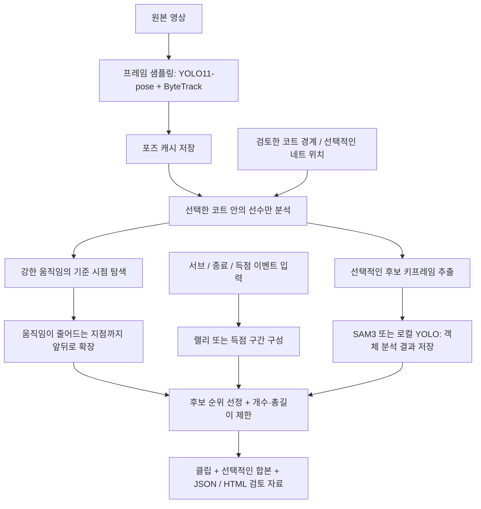

# highlight-generator

직접 촬영한 스포츠 영상에서 하이라이트 후보를 찾고 클립으로 추출합니다.
강한 움직임을 중심으로 앞뒤 구간을 확장하거나, 서브·랠리 종료·득점 이벤트로 경기 구간을 구성합니다.
포즈 패턴과 선택적인 SAM3 객체 분석 결과는 후보의 순위를 정하는 데 사용합니다.
`highlight-fusion`은 OpenCV·포즈·객체 검출·SAM을 공통 시간축에 겹쳐 보여 주고, LLM 검토용 근거 묶음을 출력합니다.

현재 결과는 검토용 후보입니다. 배드민턴 서브·착지와 축구 골을 자동으로 검출하는 모델은 아직 연동되지 않았습니다.
에이전트용 개발 지침은 간결한 영문 [AGENTS.md](AGENTS.md)에 정리합니다.

## 전체 처리 과정

**영상 입력 → 포즈 저장 → 내 코트 선수만 분석 → 후보 구간 구성·확장 → 순위 선정 → 클립 출력·검토** 순서입니다.



| 단계 | 처리 내용 | 도구·결과 |
| --- | --- | --- |
| 1. 코트 설정 | OpenCV 선 후보를 확인하고 분석할 코트의 경계를 지정합니다. 네트 기둥의 바닥 위치도 지정할 수 있습니다. | `highlight-court`, 검토한 `court.json` |
| 2. 포즈 추출 | 일부 프레임에서 CUDA/MPS로 선수 관절을 검출하고, CPU의 ByteTrack으로 선수를 연결합니다. 빠른 배드민턴 경로의 기본값은 최대 10 FPS, 입력 너비 1280 px입니다. | `highlight-pose` 또는 `highlight-detect`; `<game>_poses.npz` |
| 3. 코트 필터링 | 발이 지정 영역 안에 있는 선수만 움직임·패턴 분석에 사용합니다. 최초 YOLO 추론은 전체 프레임을 처리합니다. | 포즈 캐시 + 코트 설정 |
| 4. 객체 정보 저장 | 필요한 경우, 포즈로 좁힌 후보의 일부 프레임·선수 주변 영역만 SAM3 또는 로컬 YOLO로 분석합니다. | `highlight-detect`; `<game>_highlights.json` |
| 5. 후보 구간 구성 | 강한 움직임을 기준으로 앞뒤를 확장하거나, 입력된 경기 이벤트로 랠리·득점 구간을 만듭니다. | `highlight-plays` |
| 6. 순위 선정 | 움직임 강도, 길이, 동작 패턴, 이용 가능한 SAM 증거를 반영합니다. 겹치는 움직임 구간은 제한 범위 안에서 합치고, 개수·총길이 예산에 맞춰 선택합니다. | 점수·경계 근거가 기록된 구간 |
| 7. 출력·검토 | 선택 구간을 인코딩하고 필요하면 합본을 만듭니다. 사용자가 후보의 품질과 구간의 완결성을 확인합니다. | MP4, `<game>_plays.json`, `review.html` |

**`highlight-plays`는 새 YOLO·SAM 추론을 실행하지 않습니다.** 저장된 포즈와 선택적인 SAM 증거를 읽습니다.
객체 증거는 `highlight-detect` 또는 `highlight-patterns --refine-sam`으로 먼저 생성합니다.
새로 고른 움직임 시점 중에는 기존 SAM 분석이 없는 지점도 있을 수 있습니다.

| 방식 | 기준과 구간 구성 | 결과의 의미 |
| --- | --- | --- |
| 움직임 기반: `highlight-plays --motion-seeds` | 강한 몸·팔 움직임을 찾고, 기본 앞 12초·뒤 8초 범위에서 움직임이 줄어드는 지점을 탐색합니다. | 추정된 맥락 구간입니다. 랠리가 일부 잘리거나 움직임이 작은 좋은 플레이를 놓칠 수 있습니다. |
| 이벤트 기반: `highlight-plays --events events.json` | 배드민턴은 서브부터 종료까지, 농구·축구는 득점과 직전 전개를 묶습니다. | 입력 이벤트에 근거한 구간입니다. 경계 검증 여부는 이벤트 출처가 결정합니다. |
| 동작 분석: `highlight-patterns` | 준비 → 동작 → 회복의 순서를 검사합니다. 작은 스트로크·네트 플레이도 포함합니다. | 개별 동작을 검토하거나 경기 구간의 순위를 정하는 보조 자료입니다. |
| 통합 관측: `highlight-fusion` | 전체 프레임의 OpenCV와 서로 다른 간격의 포즈·객체·SAM 관측을 프레임 번호와 시간으로 정렬합니다. | 전체 길이 오버레이와 후보별 LLM 근거 묶음입니다. 확정된 경기 결과를 생성하지 않습니다. |

## 실행 환경

- Python 3.10 이상과 [uv](https://docs.astral.sh/uv/)를 사용합니다.
- NVIDIA 경로는 CUDA 12.8 호환 드라이버가 필요합니다. WSL2의 RTX 4060 Ti 8 GB에서 개발했으며, SAM3의 최대 VRAM 사용량은 약 3.4 GB였습니다.
- Apple Silicon은 YOLO 포즈와 SAM3 이미지 추론에 PyTorch MPS를 사용합니다. M4 Pro에서 FP16으로 검증했습니다.
- NVIDIA는 NVDEC로 디코딩하고 GPU에서 전처리·추론합니다. Mac은 OpenCV로 CPU 디코딩 후 샘플링한 RGB 프레임을 GPU로 보냅니다. ByteTrack은 두 경로 모두 CPU에서 실행합니다.
- GPU 추론을 사용할 수 없을 때 CPU 추론으로 조용히 전환하지 않습니다.

## 설치

```sh
uv sync

# SAM3는 사용 승인 후 체크포인트를 내려받아야 합니다.
# 먼저 https://huggingface.co/facebook/sam3 에서 접근 권한을 신청하세요.
uvx --from huggingface_hub hf auth login
uvx --from huggingface_hub hf download facebook/sam3 sam3.pt --local-dir models
```

YOLO11-pose 가중치는 첫 실행 때 `models/`로 내려받습니다.
SAM을 생략하는 포즈 전용 실행에는 SAM 체크포인트가 필요하지 않습니다.

## 빠른 시작

다음은 Mac에서 새 배드민턴 영상을 처리하는 순서입니다.
NVIDIA에서는 추론 단계의 장치를 `--device cuda:0`으로 바꾸세요.

```sh
# 미리보기를 확인하고, 아래 코트 설정 예시에 맞춰 court.json을 작성합니다.
uv run highlight-court path/to/game.mp4 --out-dir outputs/court-preview

# 포즈와 제한된 SAM3 분석 결과를 저장합니다. 영상 출력은 최종 선택까지 미룹니다.
uv run highlight-detect path/to/game.mp4 --sport badminton --device mps \
  --court court.json --out-dir outputs/game --no-clips --no-overlay

# 캐시를 재사용해 강한 움직임 주변을 확장하고 클립·합본을 출력합니다.
uv run highlight-plays path/to/game.mp4 --sport badminton --motion-seeds \
  --poses outputs/game/game_poses.npz --court court.json \
  --sam-evidence outputs/game/game_highlights.json \
  --max-highlights 5 --highlight-budget 120 --out-dir outputs/motion/game --reel
```

포즈만 준비하려면 두 번째 명령에 `--detail-backend none`을 지정합니다.
최종 선택에서는 `--sam-evidence`를 생략할 수 있습니다.
마지막 명령만 다시 실행하면 기존 모델 결과로 코트 경계·확장 범위·선택 예산을 조정할 수 있습니다.

세부 설정은 [코트 설정](#코트-설정), [움직임 기반 구간 확장](#움직임-기반-구간-확장), [랠리와 득점 구간](#랠리와-득점-구간)을 참고하세요.

## 움직임 기반 구간 확장

서브·착지 검출기가 없어도 강한 움직임을 먼저 찾고 앞뒤 맥락을 붙일 수 있습니다.
전체 코트의 선수가 모두 멈출 때까지 기다리지 않고, 각 기준 시점 주변을 제한된 범위에서 탐색합니다.

```sh
uv run highlight-plays path/to/game.mp4 --sport badminton --motion-seeds \
  --poses outputs/game_poses.npz --court court.json \
  --sam-evidence outputs/game_highlights.json \
  --motion-before 12 --motion-after 8 --seed-percentile 95 \
  --max-highlights 5 --highlight-budget 120 --out-dir outputs/motion/game --reel
```

연속된 선수 트랙에서 몸의 속도·속도 벡터 변화·어깨 기준 팔의 속도를 몸통 길이로 정규화합니다.
잠깐 유지되는 강한 움직임이 절대 기준과 영상 내 백분위 기준을 모두 넘어야 기준점이 됩니다.
오버헤드 자세나 완성된 스트로크 패턴은 필수 조건이 아닙니다.
가려진 손목의 움직임과 비현실적인 추적 점프는 제외하고, 지정 코트 밖의 선수는 분석하지 않습니다.
화면상 수직 이동도 몸 움직임에 반영되지만, 점프나 특정 샷의 확정 분류는 아닙니다.

기본 확장 한도는 **앞 12초·뒤 8초**입니다. 주변 움직임이 일정 시간 줄어드는 지점을 절단 후보로 사용합니다.
짧은 가림은 정지로 처리하지 않으며, 긴 관측 공백·탐색 한도·영상 경계는 각각의 종료 근거로 기록합니다.
겹치는 구간은 합친 길이가 전체 한도 안에 있을 때만 병합하고, 그보다 긴 중복 후보는 약한 쪽을 억제합니다.
최종 후보끼리는 겹치지 않습니다.

구간은 추정값으로 표시하며 서브·착지·득점이나 랠리 전체를 보장하지 않습니다.
작은 헤어핀처럼 움직임이 적은 장면은 빠질 수 있고 평범한 이동이 선택될 수도 있습니다.
카메라 움직임 보정은 아직 없습니다. 관측된 경기 경계가 필요하면 이벤트 기반 방식을 사용합니다.

## 여러 분석 결과 겹쳐 보기와 LLM 검토

분석 주기는 역할에 따라 나눕니다. OpenCV의 저렴한 연산을 많이 실행하고, 포즈·객체 검출·SAM은 다른 간격과 예산을 사용합니다.
코트의 선을 매번 새로 찾을 필요는 없으므로, 프레임 차이는 매 프레임 처리하되 선·카메라 이동 진단은 기본 2초마다 갱신합니다.

| 레이어 | 기본 범위 | 제공하는 근거 |
| --- | --- | --- |
| OpenCV | 원본의 모든 프레임, 분석 너비 640 px | 선택 코트의 움직임 비율·밝기·화면 변화 후보, 주기적인 선 후보·카메라 평행 이동 진단 |
| YOLO 포즈 | 기존 캐시 재사용; 빠른 경로는 최대 10 FPS | 코트 안 선수의 관절·발 위치·몸과 손의 움직임 |
| YOLO 객체 | 평소 최대 2 FPS, 후보 안 최대 8 FPS, 총 2,000회 제한 | 로컬 체크포인트의 원래 클래스·박스·신뢰도와 보수적으로 연결한 관측 트랙 |
| SAM3 | 저장된 관측 재사용 + 선택적인 추가 최대 18회 | 후보 중심과 전후의 선수 주변 객체 박스 |
| LLM | 후보별 요약·선택 프레임 | 관심도 판단·반대 근거·미확인 항목. 검출기 신뢰도를 하이라이트 확률로 해석하지 않음 |

종목별 프로필은 배드민턴의 라켓·셔틀, 농구의 공·골대, 축구의 공·골문 질의·클래스 필터를 지정합니다.
축구 프로필은 녹색 표면 비율도 기록하지만, 자동 필드 선택이나 골 판정은 아닙니다.
프로필과 검출기의 학습 클래스는 별개입니다. 일반 [COCO 클래스](https://docs.ultralytics.com/datasets/detect/coco/)에는
`sports ball`·`tennis racket`이 있지만 셔틀콕은 없습니다. 이를 배드민턴 클래스로 바꿔 부르지 않습니다.
전용 셔틀·라켓 모델을 준비했다면 `--object-model`로 지정하세요. 다음 예시는 로컬 COCO 가중치를 사용하며 지원하지 않는 클래스를 결과에 명시합니다.

```sh
uv run highlight-fusion path/to/game.mp4 --sport badminton \
  --poses outputs/game/game_poses.npz --court court.json \
  --candidates outputs/motion/game/game_plays.json \
  --sam-evidence outputs/game/game_highlights.json \
  --object-model models/yolo11n.pt --object-fps 2 --object-peak-fps 8 \
  --max-object-calls 2000 --refine-sam --max-sam-calls 18 \
  --top-candidates 6 --device mps --out-dir outputs/fusion/game
```

`--object-model`과 `--refine-sam`은 선택 사항입니다. 모델이 없는 상태와 검출 실패를 구분합니다.
이전 통합 분석의 `manifest.json`을 `--object-evidence`로 주면 객체 검출도 재실행하지 않습니다.
원본·종목·코트가 같은지 확인하고, 지원 클래스와 관측 주기는 원래 결과의 출처를 함께 참고합니다.
`--no-video`는 전체 영상·클립 인코딩을 생략하고 관측 데이터와 근거 프레임을 생성합니다.
모니터링하려면 동일한 인자를 `uv run python scripts/benchmark_fusion.py ... --monitor-mac`에 전달합니다.

오버레이에는 초록색 코트 경계·노란 선 후보·선수 골격·주황색 YOLO 객체·분홍색 SAM 객체를 함께 표시합니다.
포즈는 과거의 최대 0.2초 관측, 객체는 최대 0.3초, SAM은 최대 0.12초 관측만 표시하고 실제 관측 시점과 경과 시간을 적습니다.
샘플 사이를 새 검출처럼 보간하지 않습니다. 발의 코트 소속은 엄격히 검사하지만, 공중 객체는 바닥 경계 밖에 보일 수 있어
코트 안 선수와의 근접성도 기록합니다. 2D 위치만으로 공중 객체의 경기 코트나 3D 높이를 확정하지 않습니다.
현재 SAM 통합 결과는 객체 박스이며 분할 마스크는 저장하지 않습니다.
짧은 시간 간격의 SAM 이미지에서 위치가 거의 같은 셔틀 후보는 정지 물체 가능성으로 표시해 박스 지원에서 제외합니다.
원시 박스와 제외 사유는 남겨 LLM의 반대 근거로 전달합니다. 이 표시만으로 여분 셔틀이나 경기 중단을 확정하지 않습니다.

| 결과 | 내용 |
| --- | --- |
| `full_overlay.mp4` | 원본 전체 길이의 분석 오버레이, 기본 30 FPS·너비 1280 px |
| `C01_overlay.mp4` 등, `candidate_overlays.mp4` | 후보별 오버레이와 검토용 합본 |
| `opencv.jsonl`, `geometry_observations.json` | 프레임별 저비용 신호와 주기적인 선·카메라 진단 |
| `objects.jsonl`, `sam_observations.json` | 실제 검출 시점·원래 클래스·좌표·신뢰도·선수와의 관계·관측 ID |
| `sam_evidence.json` | 저장된 SAM 출처와 추가 관측을 연결한 재사용용 보고서 |
| `packets/C01.json`, `packets.jsonl` | 후보별 관측 범위·선수 요약·객체 트랙·정지 가능성·참조 이미지·미확인 항목 |
| `llm_review_prompt.md`, `review_schema.json` | Codex·Claude Code 등 에이전트가 읽을 영문 검토 지침과 출력 형식 |
| `manifest.json`, `review.html` | 관측 범위·지원 클래스·새 호출 수·시간 기록과 검토 페이지 |

LLM에는 전체 원시 JSONL을 한 번에 넣기보다 `manifest.json`과 관련 후보의 packet·세 장의 프레임부터 제공합니다.
좌표만으로 구분하기 어려운 셔틀 줍기·대기·가림은 자세와 전후 이미지도 함께 봅니다.
필요할 때 원시 관측이나 오버레이로 내려가고, `highlight_candidate`·`reject`·`needs_review` 중 하나를
실제 근거 ID·반대 근거·미확인 항목과 함께 반환하도록 합니다.

명령 자체는 외부 LLM API를 호출하거나 영상을 업로드하지 않습니다.
에이전트가 만든 JSON 판정을 다음 명령으로 적용하면 기존 오버레이 클립에서 승인한 후보만 합칩니다.
검출 모델은 다시 실행하지 않으며, 없는 후보·근거 ID 또는 LLM의 새 경계 검증 주장은 거부합니다.
판정의 `boundary_verified: false`는 LLM이 새로 검증한 경기 경계가 없다는 뜻입니다. 입력의 기존 `boundary_status`는 그대로 유지합니다.

```sh
uv run highlight-fusion-review outputs/fusion/game \
  --review decisions.json --reviewer codex
```

결과는 `reviewed.html`, `reviewed_selection.json`과 선택된 후보가 있을 때의 `reviewed_highlights.mp4`입니다.
LLM의 관심도 평가는 서브·착지·득점의 검증과 별개이며, 실제 선호를 맞추려면 사용자 라벨로 평가해야 합니다.
셔틀의 연속 궤적·접촉·착지는 전용 검출·추적 모델을 추가해야 합니다.

### 단일 영상 통합 분석 기록

[`199_0HDQ-d8` 통합 실행 기록](benchmarks/macbook-fusion-199_0HDQ-d8-2026-11-12.json)은 10분 9초 전체를 처리했습니다.
OpenCV 36,497프레임, 기존 포즈 6,083프레임, 새 YOLO 객체 분석 1,740회,
SAM은 기존 60회분에 새 15회를 추가했습니다. 초기 통합 분석·전체 길이 오버레이 출력은 173.97초였으며
그중 OpenCV 계산은 20.45초였습니다. 앞선 포즈·SAM 캐시 생성 비용은 제외한 값입니다.

정지한 작은 물체 후보 필터를 보완한 재출력은 124.52초였고 새 모델 호출은 0회였습니다.
SAM 관측 81개에 정지 가능성을 표시했고, 그중 기존 표시 대상 45개를 제외했습니다. 여전히 오검출이 남아 있어
셔틀 관측을 확정 비행 경로로 사용하지 않았습니다. 전체·후보·검토 합본의 영상과 오디오를 끝까지 디코딩해 확인했습니다.

Codex가 후보별 근거와 전후 프레임을 검토하는 시연에서는 6개 중 5개를 후보로 남기고,
수거·재정비 가능성이 있는 1개를 `needs_review`로 분류했습니다. 라벨 정답을 가린 정확도 평가가 아니며
새 경기 경계·포인트 결과를 검증하지 않았습니다. 농구·축구 프로필은 동작 테스트가 있으나 이 실제 영상 실행은 배드민턴입니다.

## 랠리와 득점 구간

| 종목 | 후보 단위 | 필요한 이벤트 |
| --- | --- | --- |
| 배드민턴 | 헤어핀·드라이브·오버헤드를 포함하는 한 랠리 | 서브부터 착지·아웃·네트 폴트·폴트·렛·포인트 종료까지 |
| 농구 | 득점과 직전 공격 전개 | 골 성공, 선택적인 공격·소유권 시작 |
| 축구 | 득점과 직전 공격 전개 | 골, 선택적인 공격 시작 |

```sh
uv run highlight-plays path/to/game.mp4 --sport badminton \
  --events events.json --poses outputs/game_poses.npz --court court.json \
  --out-dir outputs/plays/game --reel
```

`events.json`은 이벤트 검출기나 사람이 검토한 주석으로 준비합니다.
다음은 수동 검토 입력의 형식 예시이며 시간은 설명용입니다.

```json
{
  "video": "game.mp4",
  "sport": "badminton",
  "court_id": "main",
  "source": "manual_review",
  "events": [
    {"time_s": 12.4, "kind": "serve", "verified": true},
    {"time_s": 28.1, "kind": "shuttle_landed", "verified": true},
    {"time_s": 35.0, "kind": "serve", "verified": true},
    {"time_s": 48.2, "kind": "fault", "verified": true}
  ]
}
```

파일 안의 영상 경로는 이벤트 파일 위치를 기준으로 해석합니다.
`court_id`가 다른 이벤트는 제외하며, 포즈를 함께 사용하면 코트 경계도 필요합니다.
추적 끊김·가림·네트 터치 동작만으로 랠리를 끝내지 않습니다.
앞뒤 여유 시간을 붙여도 서로 다른 랠리를 합치지 않고, 시간 예산이 부족하면 랠리 전체를 건너뜁니다.
랠리 중간을 잘라 예산에 맞추지는 않습니다.

`--verified-only`는 시작·종료 이벤트가 모두 검증된 구간만 고릅니다.
관측하지 못한 경계는 미확인 상태로 유지하며, 중요도 점수와 경계 검증 여부를 분리합니다.
`--sam-evidence`를 포즈와 함께 주면 저장된 객체 증거로 동작 순위를 보조하지만 경계를 변경하거나 검증하지는 않습니다.

농구의 `highlight-detect`는 SAM3 림 통과 규칙으로 추정한 `basket_made`와 `play_candidates`를 저장합니다.
해당 JSON을 `highlight-plays --sport basketball --events ...`에 전달할 수 있습니다.
이 결과는 점수판으로 확인한 득점이 아닙니다. 축구는 외부 `goal` 이벤트가 필요합니다.

배드민턴의 자동 경계를 위해서는 연속 셔틀 추적과 접촉·종료 판별이 추가로 필요합니다.
현재의 일부 SAM 프레임만으로는 전체 비행 경로를 확인할 수 없습니다.

### 포즈 활동 구간 진단

```sh
uv run highlight-plays path/to/game.mp4 --sport badminton \
  --estimate-from-poses --poses outputs/game_poses.npz --court court.json \
  --out-dir outputs/activity-proposals --no-clips
```

이 모드는 활동·정지에 근거한 미검증 구간을 출력합니다.
정지나 셔틀 미검출을 착지로 간주하지 않습니다. 실제 영상에서는 여러 랠리가 긴 활동 구간으로 묶일 수 있으므로
랠리 자동 추출 결과로 사용하지 않습니다. 세 영상에서 확인한 한계는 [측정 기록](benchmarks/rally-boundary-data-audit-2026-11-04.json)에 남겼습니다.

## 저장된 포즈·SAM으로 동작 분석

```sh
uv run highlight-patterns path/to/game.mp4 \
  --poses outputs/game_poses.npz --sam-evidence outputs/game_highlights.json \
  --court court.json --out-dir outputs/patterns/game --reel
```

YOLO를 다시 실행하지 않고 연속 트랙에서 준비·동작·회복 순서를 검사합니다.
손목은 몸통 기준 상대 움직임으로 계산해 몸 전체의 이동을 스윙으로 오인하는 일을 줄입니다.

| 패턴 | 검사하는 순서 |
| --- | --- |
| `overhead_swing` | 손목 올림 → 빠른 팔 움직임 → 팔로스루 |
| `compact_stroke` | 작은 손·라켓 움직임 → 안정 또는 복귀; 팔을 높이 들 필요 없음 |
| `net_touch_candidate` | 설정한 네트 가까이에서의 작은 스트로크; 네트 플레이 후보 |
| `low_reach_recovery` | 낮은 손 위치와 굽히거나 벌린 다리 → 회복 |
| `repeated_action_burst` | 여러 트랙에서 긴 정지 없이 가까운 시간에 발생한 세 번 이상의 동작 |

학습한 하이라이트 선호 모델이 아니라 직접 작성한 시간 순서 규칙입니다.
낮게 뻗는 동작은 셔틀 줍기일 수 있어 기본 클립 선택에서는 제외하고, `--include-low-reach`로 포함할 수 있습니다.
작은 스트로크와 네트 동작은 오버헤드 없이도 묶음 후보를 만들 수 있습니다.
코트 필터링을 먼저 적용하며, 네트 동작만으로 헤어핀·스매시·타구·위닝샷·완전한 랠리를 확정하지 않습니다.
[배드민턴 타구 시점 검출 연구](https://arxiv.org/abs/2306.10293)도 시간 순서 문제를 다루지만, 이 구현은 해당 학습 모델을 사용하지 않습니다.

SAM은 손 근처의 크기가 타당한 라켓이나 움직이는 작은 객체를 제한적인 순위 보조 정보로 사용합니다.
바닥의 셔틀·정지한 객체·너무 큰 객체·멀리 있는 라켓은 제외합니다.
분석하지 않은 시점은 미확인 상태로 두며, 객체 미검출을 실패한 동작으로 해석하지 않습니다.
원본 프레임·좌표·영상 크기로 연결하므로 서로 다른 포즈 추출 설정의 트랙 ID가 같을 필요는 없습니다.
저장된 분석의 출처를 따라 추가 SAM 프레임도 재사용하고, 다른 선수를 자른 영역은 분석 범위로 인정하지 않습니다.

추가 객체 분석이 필요한 동작만 제한적으로 확인하려면 다음과 같이 실행합니다.

```sh
uv run highlight-patterns path/to/game.mp4 \
  --poses outputs/game_poses.npz --sam-evidence outputs/game_highlights.json \
  --court court.json --out-dir outputs/patterns/game --refine-sam --device mps \
  --max-sam-calls 15 --max-highlights 5 --highlight-budget 40 --reel
```

`--court`는 저장된 코트 경계를 덮어씁니다. 동작 분석에는 경계가 필요하며 발 위치 필터의 여유 폭은 0입니다.
SAM 입력은 생략할 수 있고, `--no-clips --no-previews`는 미디어 출력 없이 데이터만 분석합니다.
반복 패턴의 빈도와 개인이 선호하는 하이라이트는 별개입니다. 선호를 학습하려면 좋은 장면과 평범한 장면의 라벨이 필요합니다.

## 코트 설정

```sh
# YOLO·SAM과 별개로 실행하는 CPU OpenCV 진단입니다.
uv run highlight-court path/to/game.mp4 --out-dir outputs/court-preview
```

영상 초반 프레임의 중앙값 영상에서 Canny와 [확률적 허프 변환](https://docs.opencv.org/4.x/d9/db0/tutorial_hough_lines.html)으로 긴 선을 찾습니다.
벽·천장 경계를 줄이기 위해 화면 아래쪽 60%를 탐색합니다.
미리보기의 노란 선은 코트 경계 후보이며, 다른 종목의 선과 옆 코트가 섞일 수 있습니다.
고정된 실내 카메라를 가정하며 분석할 코트를 자동으로 선택하지 않습니다.

분석할 코트의 네 꼭짓점을 둘레 순서로 지정하세요. 다음 좌표는 예시이므로 실제 영상에 맞춰 수정해야 합니다.

```json
{"normalized": true, "polygon": [[0.2, 0.45], [0.8, 0.45], [0.95, 0.95], [0.05, 0.95]], "net": [[0.3, 0.6], [0.85, 0.65]]}
```

```sh
uv run highlight-detect path/to/game.mp4 --sport badminton --device mps --court court.json
```

`normalized: true`이면 좌표는 영상 크기에 대한 비율이고, 생략하면 원본 픽셀 좌표입니다.
초록색은 지정한 경계, 청록색 `net`은 **두 네트 기둥의 바닥 위치**를 이은 선입니다.
네트의 위쪽 테이프가 아니라 코트 바닥 기준 위치를 지정해야 전위의 작은 동작을 구분하는 데 쓸 수 있습니다.

발이 영역 안에 있는 선수만 후보 분석에 반영합니다. 코트 제한은 불필요한 후보와 상세 모델 호출을 줄이지만
전체 프레임을 처리하는 초기 YOLO 추론 비용을 줄이지는 않습니다.
포즈 캐시는 원본·체크포인트 식별 정보, stride, 입력 너비, confidence가 일치할 때 재사용합니다.
코트나 순위 설정만 바꾸면 포즈를 다시 추출할 필요가 없습니다.

## 빠른 배드민턴 분석과 객체 검출

```sh
uv run highlight-detect path/to/game.mp4 --sport badminton --device mps \
  --sam-model models/sam3.pt

# SAM과 체크포인트 없이 포즈 후보만 추출합니다.
uv run highlight-detect path/to/game.mp4 --sport badminton --device mps \
  --detail-backend none
```

기본값은 YOLO11s-pose, 최대 10 FPS, 입력 너비 1280 px입니다.
선수의 오버헤드·손목·몸 움직임을 점수화하고 앞뒤 3초를 붙여 겹치지 않는 후보를 고릅니다.
영상당 최대 30개·총 120초이며, 시간대별 강한 후보를 우선 확보해 초반 구간이 예산을 독점하지 않게 합니다.
단순히 팔을 든 채 서 있는 장면만으로는 후보가 되지 않습니다.

SAM3는 선택된 시점당 기본 세 프레임, 영상당 최대 90회 호출합니다.
선수 주변을 확장해 자른 이미지에서 `badminton racket`과 `shuttlecock`을 한 번에 질의합니다.
객체 미검출만으로 포즈 후보를 버리지 않습니다. 일반 YOLO 포즈 가중치는 셔틀을 검출하지 않습니다.

먼 선수의 포즈가 누락되면 해상도나 분석 예산을 조절해 비교할 수 있습니다.

```sh
uv run highlight-detect path/to/game.mp4 --sport badminton --device mps \
  --pose-fps 10 --input-width 1920 --max-highlights 15 \
  --highlight-budget 90 --detail-keyframes 3 --max-detail-calls 45
```

상세 분석에는 직접 준비한 YOLO 검출·분할 체크포인트도 사용할 수 있습니다.

```sh
uv run highlight-detect path/to/game.mp4 --sport badminton --device mps \
  --detail-backend yolo --object-model models/badminton-objects.pt
```

전용 셔틀 검출 모델은 포함되어 있지 않습니다. 체크포인트의 클래스 이름을 그대로 사용하며
COCO의 `sports ball`이나 `tennis racket`을 배드민턴 클래스로 바꾸어 해석하지 않습니다.
동일한 키프레임 호출 예산을 적용합니다.

추가 검토 대상은 [YOLOE](https://docs.ultralytics.com/models/yoloe/)의 텍스트·시각 프롬프트 객체 검출과
[TrackNetV3](https://github.com/qaz812345/TrackNetV3)의 시간 순서 기반 셔틀 추적입니다.
둘 다 이 구현의 작은 셔틀 정확도·Mac 처리량 검증이 완료된 상태는 아니며, TrackNetV3는 아직 연동되지 않았습니다.

## 농구·축구 분석 경로

```sh
uv run highlight-detect path/to/video.mp4 --sport basketball
uv run highlight-detect path/to/video.mp4 --sport football
uv run highlight-pose path/to/video.mp4 --device mps --no-overlay
uv run highlight-detect path/to/video.mp4 --sport basketball --device mps --sam-model models/sam3.pt
```

이 경로의 기본 포즈 설정은 입력 너비 1920 px, 세 프레임마다 한 번입니다.
농구는 머리보다 손목이 몸통 길이의 0.3 이상 높은 `arms_up`, 축구는 양 발목 높이 차이가 몸통 길이의 0.6 이상인
`foot_up`을 단서로 씁니다. 가까운 활성 프레임을 묶고 앞 1.5초·뒤 2초를 붙입니다.

농구 SAM3는 고정 카메라와 하나의 골대를 가정합니다.
골대를 찾은 후 림 주변 644 px 영역에서 두 프레임마다 공을 분석하고, 위치를 림 너비로 정규화합니다.
공이 림 중앙 부근 높이를 통과해 아래로 계속 내려가면 `made`, 림 위로 올라갔지만 통과하지 않으면 `miss`,
골대 주변에서 슛을 관측하지 못하면 `noshot`으로 분류합니다. `noshot`은 클립을 만들지 않습니다.

축구에는 아직 SAM 득점 판정 단계가 없어 포즈 후보를 클립으로 만듭니다.
달리기·차기 자세만으로 골을 생성하지 않으며, 득점 중심 구간을 만들려면 외부 `goal` 이벤트가 필요합니다.

## 출력과 검토

기본 출력 위치는 명령별 `--out-dir`로 바꿀 수 있습니다. 자세한 옵션은 각 명령의 `--help`로 확인합니다.

| 명령 | 주요 결과 |
| --- | --- |
| `highlight-pose` | 박스·트랙 ID·17개 관절을 담은 `<game>_poses.npz`, 선택적인 `<game>_pose.mp4` 포즈 영상 |
| `highlight-detect` | `<game>_highlights.json`, 포즈 캐시, 후보 클립. 배드민턴은 코트 JSON·미리보기·객체 JPEG, 농구는 골대·공 궤적·판정 오버레이도 출력 |
| `highlight-plays` | `<game>_plays.json`, 후보별 H.264 클립, `review.html`, 선택적인 `<game>_plays.mp4` 합본 |
| `highlight-patterns` | `<game>_patterns.json`, `patterns.csv`, 동작 JPEG, `review.html`, H.264 클립·선택적인 합본 |

JSON에는 시각·점수·경계 근거·설정·객체 정보·모델 호출 수·단계별 소요 시간을 기록합니다.
`highlight-detect` 클립은 스트림 복사이므로 앞 키프레임부터 시작할 수 있습니다. iPhone 영상에서는 약 1초 차이가 날 수 있습니다.
`highlight-plays`와 `highlight-patterns`의 검토 클립은 재인코딩해 지정 구간을 자릅니다. 이 작업은 CPU 시간을 사용합니다.

`--no-clips`는 클립 생성을 생략합니다. 포즈·검출 경로의 `--no-overlay`는 포즈 영상·상세 JPEG 또는 오버레이를 생략합니다.
동작 분석의 JPEG는 `--no-previews`로 생략합니다. 검토 클립은 16:9 입력 기준 720p30 H.264이며 오디오가 있으면 AAC로 인코딩합니다.

## 벤치마크와 Mac 성능 추적

모델·원본 영상을 미리 내려받고 **새 추론 시간과 캐시 재사용·미디어 출력 시간을 구분**해 측정합니다.
Windows와 비교할 때는 동일한 원본, 가중치, 해상도, stride를 사용하세요.
같은 stride라면 60 FPS 영상은 30 FPS 영상보다 추론 프레임 수가 두 배입니다.

### 새 추론 측정

```sh
# 포즈만 측정합니다. 새 출력 폴더를 사용해 캐시 재사용을 막습니다.
uv run python scripts/benchmark_pose.py data/video1.mp4 data/video2.mp4 data/video3.mp4 \
  --out-dir outputs/macbook/pose-run --device mps --monitor-mac

# 빠른 배드민턴 경로의 새 포즈 + 제한된 객체 분석을 측정합니다.
uv run python scripts/benchmark_pose.py path/to/game.mp4 --pipeline badminton \
  --device mps --monitor-mac --out-dir outputs/macbook/fast-run

# 농구의 포즈 + SAM 호환성은 짧은 영상에서 먼저 확인합니다.
uv run python scripts/benchmark_pose.py data/short-clip.mp4 \
  --pipeline combined --sport basketball --sam-model models/sam3.pt \
  --device mps --monitor-mac --out-dir outputs/macbook/combined-smoke
```

포즈 측정은 프로세스·모델 시작, 디코딩·GPU 업로드, 추론, CPU 추적, 캐시 저장을 포함하고 오버레이는 생략합니다.
기본 설정은 YOLO11s-pose, 너비 1920 px, FP16, 세 프레임마다 한 번입니다.
배드민턴 경로는 별도의 최대 10 FPS·1280 px 설정을 사용합니다.
`combined`는 농구 SAM 경로이며, 배드민턴 영상에 실행한 수치는 호환성·속도 측정으로만 해석합니다.
배드민턴·combined 벤치마크는 클립·오버레이 출력을 생략합니다. SAM을 사용하는 실행은 가중치가 없으면 포즈 추출 전에 중단합니다.

`benchmark.json`에는 실행 시간·처리량·버전·설정·단계별 시간·부모 프로세스의 최대 RSS를 저장합니다.
영상별 로그와 포즈 캐시도 생성합니다. 처리량만으로 후보 정확도가 같다고 볼 수는 없습니다.

### 캐시를 재사용한 후보 추출 측정

캐시는 `<root>/<영상 이름>/<영상 이름>_poses.npz`와 대응하는 SAM 보고서 형태로 준비합니다.
코트 파일은 `<court-root>/<영상 이름>.json`입니다.

```sh
# 움직임 기준 확장 + 클립·합본 출력. 새 YOLO·SAM 추론은 실행하지 않습니다.
uv run python scripts/benchmark_patterns.py data/game1.mp4 data/game2.mp4 \
  --pose-root outputs/pose-cache --sam-root outputs/sam-cache \
  --court-root outputs/courts --out-dir outputs/motion-run \
  --motion-seeds --max-highlights 5 --highlight-budget 120 --reel --monitor-mac

# 동작 분석 + 제한된 추가 SAM 분석. 새 SAM 호출은 별도로 기록합니다.
uv run python scripts/benchmark_patterns.py data/game1.mp4 data/game2.mp4 \
  --pose-root outputs/pose-cache --sam-root outputs/sam-cache \
  --court-root outputs/courts --out-dir outputs/pattern-run \
  --refine-sam --reel --monitor-mac
```

이 측정은 캐시 생성 비용을 제외하고 선택·클립·합본 등 요청한 출력을 포함합니다.
동작 분석은 JPEG도 출력합니다. 움직임 방식에는 `--court-root`가 필요하며 추가 SAM 추론 옵션을 함께 사용하지 않습니다.

### 성능 그래프

`--monitor-mac`은 전체 실행의 CPU/GPU·메모리·swap·열압력을 기록합니다.
별도 터미널에서 수동으로 모니터를 시작할 수도 있습니다.

```sh
uv run python scripts/monitor_mac.py outputs/macbook/pose-run
uv run python scripts/plot_mac_benchmark.py outputs/macbook/pose-run
```

2초마다 측정하고 벤치마크 완료 후 15초의 대기 구간까지 기록합니다.
그래프와 시계열은 PNG·CSV로 저장합니다.
CPU/GPU 수치는 다른 앱을 포함한 Mac 전체 값이며, GPU 메모리는 공유 RAM입니다.
프로세스 RSS는 GPU 전체 메모리 사용량이 아니고, 부모 프로세스 RSS에는 FFmpeg 자식 메모리가 포함되지 않습니다.
열압력은 macOS의 상태 지표이며 섭씨 온도가 아닙니다.

### 기록된 측정 결과

아래는 M4 Pro, GPU 20코어, 통합 메모리 48 GB에서 같은 세 배드민턴 영상으로 측정한 기록입니다.
전체 영상은 약 33분 47초입니다. 샘플링·선택 방식·출력 범위가 다르므로 시간만으로 정확도를 비교할 수 없습니다.

| 측정 | 시간 | 범위·결과 | 기록 |
| --- | --- | --- | --- |
| YOLO 포즈 | 약 22분 42초 | 새 포즈 추론·추적·저장 | [2026-10-31](benchmarks/macbook-m4-pro-2026-10-31.json) |
| 초기 농구 규칙 + SAM | 4시간 30분 35초 | 새 추론. SAM 28,941회, 분석이 전체 실행의 91% | [2026-11-01](benchmarks/macbook-m4-pro-combined-2026-11-01.json) |
| 빠른 배드민턴 경로 | 9분 40초 | 새 포즈·SAM 추론, SAM 180회. 후보 60개 출력은 별도 16.6초 | [2026-11-02](benchmarks/macbook-m4-pro-sparse-2026-11-02.json) |
| 동작 패턴 | 16.65초 | 캐시 재사용·검토 출력. 오버헤드 9개 + 반복 동작 묶음 6개, 약 82초 | [2026-11-03](benchmarks/macbook-patterns-2026-11-03.json) |
| 코트·네트 동작 | 22.83초 | 캐시 재사용·출력. 네트 후보 6개 + 작은 스트로크 3개 + 오버헤드 3개 + 반복 묶음 3개 | [2026-11-03](benchmarks/macbook-netplay-2026-11-03.json) |
| 포즈 활동 경계 진단 | 9.05초 | 캐시 재사용. 긴 구간 1·2·1개, 검증된 랠리 0개, 120초 예산 내 선택 클립 0개 | [2026-11-04](benchmarks/rally-boundary-data-audit-2026-11-04.json) |
| 움직임 기준 확장 | **30.24초** | 캐시 재사용·출력. 기준점 197개 → 후보 104개 → 클립 15개·합본 3개, 선택 구간 총 239.88초 | [2026-11-07](benchmarks/macbook-motion-seeds-2026-11-07.json) |

마지막 움직임 추출의 새 YOLO·SAM 호출은 모두 0회였고 부모 프로세스 최대 RSS는 0.32 GiB였습니다.
동작·네트·활동 경계 진단의 새 모델 호출도 0회이며, 앞서 수행한 추론·일부 추가 SAM 분석 비용은 각 보고서에서 구분합니다.
기존 패턴 보고서에는 [앞선 추가 분석](benchmarks/macbook-patterns-2026-11-02.json)과 소스·체크포인트 검증 기록도 연결되어 있습니다.

빠른 배드민턴 경로의 영상별 분석 시간은 다음과 같습니다.

| 영상 | 원본 길이 | 분석 | SAM 호출 |
| --- | --- | --- | --- |
| `lp2hhnV7QXY` | 11:52 | 3:12 | 60 |
| `iw0UE2AipIc` | 11:59 | 3:28 | 60 |
| `0dj21Djz180` | 9:55 | 2:59 | 60 |

모든 시간은 기록 당시 설정의 실행 결과입니다. 일부 실행은 전원·충전 조건이 달랐습니다.
원시 SAM 결과에는 바닥의 여분 셔틀과 오검출이 있었고, 코트를 제한하지 않은 초기 후보에는 옆 코트 선수도 포함됐습니다.
정확한 코트·네트 주석과 개인의 하이라이트 선호는 추가 검토가 필요합니다.
아직 후보 정밀도, 랠리 전체 재현율, 포인트 결과를 라벨 데이터로 평가하지 않았습니다.

## 검증

GPU 추론 없이 동작 규칙을 확인하는 테스트입니다.

```sh
uv run python -m unittest discover -s tests -v
```

모델·영상·생성된 미디어는 커밋하지 않고, 작은 벤치마크 JSON만 저장소에 포함합니다.
개발 시 읽을 파일과 핵심 규칙은 [AGENTS.md](AGENTS.md)를 참고하세요.

## 현재 한계

- 카메라 움직임을 보정하지 않으며, 농구는 고정 카메라와 한 개의 골대를 가정합니다.
- 여러 코트가 보이는 영상은 명시적인 경계 설정이 필요합니다. 제안된 영역 안에 있다는 사실만으로 실제 경기 코트를 올바르게 구분했다고 보장할 수는 없습니다.
- 작은 셔틀의 연속 궤적·접촉·착지 판별은 미구현입니다. 포즈나 드문 객체 관측으로 위닝샷·완전한 랠리를 확정하지 않습니다.
- 움직임 기반 방식은 작은 기술 동작을 놓치거나 일반적인 이동을 선택할 수 있습니다.
- 농구·축구의 초기 자세 단서와 이후의 움직임·동작 규칙은 정확도 평가가 더 필요합니다.

## 이전 코드

`detector/`와 `videos/`는 2019년 경기 중계 하이라이트 CNN 분류 실험입니다.
별도의 `requirements.txt`를 사용하며 현재 `src/highlight/` 파이프라인과 코드를 공유하지 않습니다.
