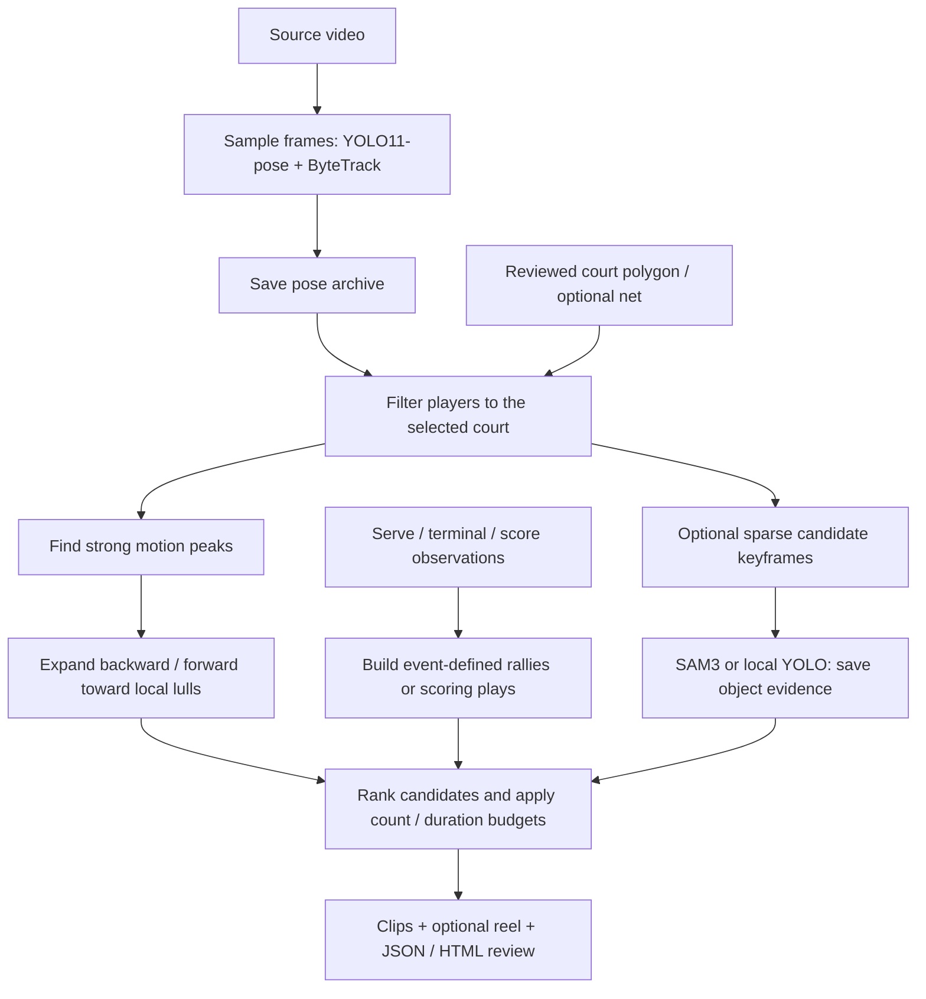

# highlight-generator

Finds the highlights in your own sports videos and cuts them into clips.

Highlight candidates can start from sport events or strong movement. Event mode
preserves a badminton rally or the build-up to a basketball/football score.
Motion-seed mode finds strong pose-motion peaks and expands their context using
local lulls and bounded searches. Pose patterns and optional saved SAM3 evidence
help rank candidates. Individual arm movements never verify rally boundaries.

The repository includes event-driven unit selection and experimental pose/SAM
detectors. A continuous badminton serve/landing detector and a football goal detector
are still required to generate those observations automatically.

On NVIDIA, frames are decoded with NVDEC and stay in GPU memory through preprocessing
and inference. Pose extraction also supports Apple MPS: OpenCV decodes on the CPU and
uploads sampled RGB frames to the Apple GPU. Both paths run ByteTrack on the CPU;
neither silently falls back to CPU model inference.

## Pipeline overview

The current workflow is **video → cached player poses → court-scoped candidates →
context expansion → ranking → review clips**. Strong movement provides a starting
point when serve/landing observations are unavailable. Supplied sport events offer
a separate path to whole rallies or scoring plays.



| Stage | What happens | Tool / saved result |
| --- | --- | --- |
| 1. Choose the court | Inspect OpenCV line candidates, then supply the target court polygon; optionally mark net-post ground positions. Court selection requires review. | `highlight-court`, `court.json` |
| 2. Extract poses once | Sample the video, detect player keypoints on CUDA/MPS, and associate players with CPU ByteTrack. The fast badminton path defaults to at most 10 FPS at 1280 px width. | `highlight-pose` or `highlight-detect`; `<game>_poses.npz` |
| 3. Restrict attention | Keep players whose feet are inside the supplied polygon before motion/pattern analysis. This filters candidates without cropping the initial whole-frame YOLO pass. | Cached poses + court configuration |
| 4. Cache optional object evidence | Inspect a bounded set of coarse pose-candidate crops/keyframes with SAM3 or a local YOLO object checkpoint. Save detections for reuse rather than analyzing every video frame with SAM3. | `highlight-detect`; `<game>_highlights.json` |
| 5. Propose final intervals | Find strong body/arm-motion peaks and expand their context, or construct rallies/scoring plays from supplied events. See the mode table below. | `highlight-plays` |
| 6. Rank and select | Use motion strength, duration, temporal action matches, and available SAM support. Merge bounded overlapping motion contexts, then select within count/time budgets. Event mode selects or skips whole units. | Selected intervals with scores and boundary/cut reasons |
| 7. Export and review | Encode the selected contexts, optionally concatenate a reel, and inspect the clips and evidence. Candidate quality and boundary completeness still need human evaluation. | `highlight-plays`; MP4 clips/reel, `<game>_plays.json`, `review.html` |

The pose and object-evidence caches are reusable. **`highlight-plays` runs no new
YOLO/SAM inference**: it consumes poses and optional SAM evidence. Generate object
evidence with `highlight-detect`, or add bounded action-level refinement with
`highlight-patterns --refine-sam`, before reusing it in selection. Sparse evidence
may cover only some of the newly selected motion peaks.

| Selection mode | Starting signal and expansion | Meaning of the output |
| --- | --- | --- |
| **Motion context**: `highlight-plays --motion-seeds` | Strong sustained body/arm-motion peaks; search up to 12 seconds before and 8 after each peak by default. Local lulls, visibility gaps, and limits determine suggested cuts. | Estimated highlight contexts, which may contain incomplete rallies. Quiet skillful play may be missed. |
| **Sport events**: `highlight-plays --events events.json` | Badminton service → terminal event; basketball made basket or football goal with lead-up context. Event input is filtered by `court_id`. | Event-defined plays; verification comes from the supplied observations, independently of ranking. Automatic badminton serve/landing and football goal detectors remain to be integrated. |
| **Action inspection**: `highlight-patterns` | Ordered preparation/movement/recovery patterns, including compact/net actions without an overhead requirement. | Individual action candidates and supporting evidence for inspection or within-play ranking. |

### From a fresh badminton video

After [setup](#setup), the following sequence prepares the caches and extracts
motion-context highlights on a Mac. Use `--device cuda:0` for the inference step on
an NVIDIA GPU.

```sh
# Inspect the court, then create court.json for your recording using the example below.
uv run highlight-court path/to/game.mp4 --out-dir outputs/court-preview

# Extract poses and bounded SAM3 evidence; defer media export until final selection.
uv run highlight-detect path/to/game.mp4 --sport badminton --device mps \
  --court court.json --out-dir outputs/game --no-clips --no-overlay

# Reuse those caches, expand strong motion peaks, and export the selected contexts.
uv run highlight-plays path/to/game.mp4 --sport badminton --motion-seeds \
  --poses outputs/game/game_poses.npz --court court.json \
  --sam-evidence outputs/game/game_highlights.json \
  --max-highlights 5 --highlight-budget 120 --out-dir outputs/motion/game --reel
```

For pose-only preparation, use `--detail-backend none` in the inference step;
SAM evidence is optional in selection. Rerun the final command to adjust context
limits, court filtering, or selection budgets while reusing the saved model outputs.
See [court calibration](#court-lines-and-player-filtering),
[motion-seed settings](#motion-seeded-context-highlights), and
[event inputs](#rallies-and-scoring-plays) for the configuration details.

Measure initial inference separately from cached selection/export. For example,
the recorded 30.24-second motion run reused earlier YOLO/SAM results and includes
clip/reel encoding. The [benchmark workflow](#benchmark-the-sparse-pipeline) tracks
Mac CPU/GPU, memory, swap, and thermal pressure; whole-Mac counters include other
apps. `scripts/benchmark_patterns.py --motion-seeds --monitor-mac` measures the
cached motion-context path.

## Requirements

- An NVIDIA GPU with a driver that supports CUDA 12.8. Developed on an RTX 4060 Ti (8 GB)
  under WSL2. SAM 3 peaks at about 3.4 GB of VRAM.
- Apple Silicon Macs can use PyTorch MPS for both YOLO pose and the SAM 3 image
  inference stage. The combined path has been verified on an M4 Pro with FP16;
  SAM 3 still requires its gated checkpoint.
- [uv](https://docs.astral.sh/uv/)

## Setup

```sh
uv sync

# SAM 3 weights are gated: request access at https://huggingface.co/facebook/sam3 first.
uvx --from huggingface_hub hf auth login
uvx --from huggingface_hub hf download facebook/sam3 sam3.pt --local-dir models
```

The YOLO11-pose weights are downloaded into `models/` on the first run.

### Motion-seeded context highlights

This mode works without a serve/landing detector: find a strong movement first,
then search backward and forward for context rather than requiring the whole
court to stop. It reuses existing pose/SAM archives and performs no new inference.

```sh
uv run highlight-plays path/to/game.mp4 --sport badminton --motion-seeds \
  --poses outputs/game_poses.npz --court court.json \
  --sam-evidence outputs/game_highlights.json \
  --motion-before 12 --motion-after 8 --seed-percentile 95 \
  --max-highlights 5 --highlight-budget 120 --out-dir outputs/motion/game --reel
```

`--sam-evidence` is optional. Body speed, body velocity change, and arm speed
relative to the shoulders are measured in torso lengths within continuous tracks.
Strong sustained peaks must pass an absolute gate and the video's motion
percentile; they need neither an overhead pose nor a completed stroke pattern.
Hidden wrists, implausible track jumps, and players outside the supplied polygon
cannot supply motion peaks. Image-plane vertical motion may support a candidate,
but is not a verified jump or shot-type classification.

Each peak expands toward sustained **local motion lulls**, with default limits of
12 seconds before and 8 seconds after. Brief occlusions do not count as stillness;
long visibility gaps and search limits remain explicit cut reasons. Overlapping
contexts merge only when their union fits the total context limit; weaker overlaps
are suppressed. Candidates remain disjoint and estimated. They may contain an
incomplete rally; use event mode when observed full-rally boundaries are required.
Quiet skillful shots may be missed, and ordinary movement may still be selected.
Camera movement is not compensated. These are review candidates, not validated
highlight preferences or point outcomes.

The [Mac motion-seed benchmark](benchmarks/macbook-motion-seeds-2026-11-07.json)
used all three saved videos and extracted 15 clips plus three H.264 reels in
**30.24 seconds**, including media export. Peak parent-process RSS was **0.32 GiB**;
this excludes FFmpeg child memory and the earlier YOLO/SAM inference. All new
YOLO/SAM call counts were zero. The 197 motion seeds yielded 104 bounded context
candidates; five per video were selected, totaling 239.88 seconds. Candidate
precision, complete-rally recall, and point outcomes have not been validated.

### Rallies and scoring plays

| Sport | Candidate unit | Boundary/outcome observations |
| --- | --- | --- |
| Badminton | One rally, including hairpins, drives, and overheads | Service until shuttle landing, landing out, net fault, fault, let, or point-end observation |
| Basketball | Scoring play with lead-up context | Made-basket observation, optionally an attack/possession start |
| Football | Scoring play with attack context | Goal observation, optionally an attack start |

```sh
uv run highlight-plays path/to/game.mp4 --sport badminton \
  --events events.json --poses outputs/game_poses.npz --court court.json \
  --out-dir outputs/plays/game --reel
```

The `events.json` input comes from a boundary/outcome detector or reviewed
annotations. Example **manually reviewed** observations (timestamps are illustrative):

```json
{
  "video": "game.mp4",
  "sport": "badminton",
  "court_id": "main",
  "source": "manual_review",
  "events": [
    {"time_s": 12.4, "kind": "serve", "verified": true},
    {"time_s": 28.1, "kind": "shuttle_landed", "verified": true},
    {"time_s": 35.0, "kind": "serve", "verified": true},
    {"time_s": 48.2, "kind": "fault", "verified": true}
  ]
}
```

Paths in the event file are resolved relative to that file. `court_id` excludes
neighboring-court events, and pose ranking requires a court polygon. Track loss,
occlusion, and a net-touch action do **not** end a rally. Padding does not merge
adjacent rallies. A duration budget selects or skips whole units; it never shortens
a rally to fit. `--verified-only` requires both boundary observations to be verified
by the event source, independently of the interest score. Unobserved starts/ends
remain explicitly unknown.

Optionally pass `--sam-evidence outputs/game_highlights.json` with the cached poses
to reuse object evidence when ranking actions inside each rally. It adds no model
calls and cannot change or verify a rally boundary.

Basketball `highlight-detect` output now includes inferred `basket_made` events
from its SAM3 rim-crossing rule and wider `play_candidates`. These observations can
be passed directly to `highlight-plays --sport basketball --events ...`. They are
not verified scoreboard readings. Football requires externally supplied `goal`
events; running/kicking poses cannot manufacture a goal.

`highlight-plays` itself consumes events and does not train or run a serve,
landing, or football-goal detector. Continuous shuttle tracking plus contact/outcome
recognition is the missing badminton boundary source. The current sparse SAM3
cache does not contain enough flight history to establish these endpoints.

For diagnosing that limitation, an explicit estimate mode is available:

```sh
uv run highlight-plays path/to/game.mp4 --sport badminton \
  --estimate-from-poses --poses outputs/game_poses.npz --court court.json \
  --out-dir outputs/activity-proposals --no-clips
```

It emits activity/pause proposals with unverified boundaries. It does not call a
pause or a missing shuttle a landing. In the existing footage this can merge many
rallies into a long activity interval, so these outputs are not confirmed rally
segments. The action-pattern workflow below remains useful for inspecting/ranking
motion inside future event-defined rallies.

The [three-video data audit](benchmarks/rally-boundary-data-audit-2026-11-04.json)
took 9.05 seconds using cached poses, with no YOLO/SAM calls and peak process RSS
of 0.30 GiB. It produced 1, 2, and 1 long activity intervals, **zero verified rallies**,
and no selected clips under the 120-second budget. This measures an unsuccessful
pose-boundary diagnostic, not automatic rally extraction or model inference speed.

### Fast badminton highlights

```sh
uv run highlight-detect path/to/game.mp4 --sport badminton --device mps \
  --sam-model models/sam3.pt

# Pose candidates only, without loading SAM or requiring its weights:
uv run highlight-detect path/to/game.mp4 --sport badminton --device mps \
  --detail-backend none
```

This path samples YOLO11s-pose at **at most 10 FPS**, using **1280 px width**.
It ranks overhead-motion and movement candidates, selects non-overlapping windows
with three seconds of context on each side, and limits output to 30 moments and
120 seconds of footage per video. Selection first takes the strongest eligible moment
from each active time bin, so an early busy section cannot consume the entire budget.
It uses ByteTrack IDs to compare the same player over time. A stationary raised arm
alone does not trigger a moment.

SAM 3 then inspects **three keyframes per selected moment**, with a hard limit of
**90 model calls per video**. Each call queries `badminton racket` and `shuttlecock`
together on an expanded crop around the player. Missed objects do not discard the
pose candidate. SAM is an optional source of object evidence, not a smash/winner
classifier. Standard YOLO pose weights do not detect shuttlecocks.

The output includes `_highlights.json`, `_poses.npz`, `_court.json`, a `_court.jpg`
preview, candidate MP4 clips, and annotated detail JPEGs. `--no-clips` skips cutting;
`--no-overlay` skips detail JPEGs. The JSON records selected frames, raw object
confidence/boxes, actual sampling settings, and per-stage time/model call counts.

Tune the budget or preserve higher pose resolution when distant players are missed:

```sh
uv run highlight-detect path/to/game.mp4 --sport badminton --device mps \
  --pose-fps 10 --input-width 1920 --max-highlights 15 \
  --highlight-budget 90 --detail-keyframes 3 --max-detail-calls 45
```

These are motion-based highlight **candidates**. They do not identify winners,
shuttle contacts, rally boundaries, or shot types reliably without evaluation and
additional badminton training data. Faster sampling/resolution changes need visual
comparison against the original pose settings.

### Extract action patterns from saved pose and SAM data

```sh
uv run highlight-patterns path/to/game.mp4 \
  --poses outputs/game_poses.npz \
  --sam-evidence outputs/game_highlights.json \
  --court court.json --out-dir outputs/patterns/game --reel
```

This reuses the archives and **does not run YOLO**. It matches ordered sequences
within continuous player tracks, using body-relative wrist motion so camera distance
and whole-body translation do not masquerade as a swing:

| Pattern | Sequence checked |
| --- | --- |
| `overhead_swing` | Raised wrist, fast arm movement, then a measurable follow-through |
| `compact_stroke` | A smaller hand/racket movement followed by settling or return; no raised-arm requirement |
| `net_touch_candidate` | A compact stroke by a player near the configured net; a candidate for net play, not a confirmed hairpin |
| `low_reach_recovery` | Fast low hand movement with bent/wide legs, then recovery |
| `repeated_action_burst` | At least three nearby actions across multiple track IDs, with no long pause |

These are hand-authored temporal rules, **not a trained highlight-preference model**.
A burst may come from adjacent courts without a court boundary. A low reach can
also be a pickup, so it is analyzed but excluded from clip selection by default;
`--include-low-reach` enables that exploratory category. Default bursts group the
eligible strokes on the selected court, including compact/net actions. None of the labels establishes a smash, shuttle contact, winning
point, or complete rally. The JSON records the phase timestamps and measurements
for inspection. Research on [badminton hitting-event detection](https://arxiv.org/abs/2306.10293)
also treats hitting as a temporal recognition problem; this implementation uses
explicit pose rules rather than that paper's trained image model.

Saved SAM detections add limited ranking support when a plausible racket is near
the player's hand. Floor-level/static shuttles, oversized objects, and distant
rackets are rejected as support. Sparse detections do not establish a shuttle
trajectory. Missing SAM coverage means unknown, rather than a failed action.
Frame coordinates and geometry associate evidence, so archives extracted with
different YOLO sampling settings do not need matching track IDs.

To inspect selected actions that lack existing evidence, add a bounded refinement:

```sh
uv run highlight-patterns path/to/game.mp4 \
  --poses outputs/game_poses.npz --sam-evidence outputs/game_highlights.json \
  --court court.json --out-dir outputs/patterns/game --refine-sam --device mps \
  --max-sam-calls 15 --max-highlights 5 --highlight-budget 40 --reel
```

The output includes 720p30 H.264/AAC review clips and an optional reel, annotated JPEGs,
`review.html`, a measurements CSV, and `<game>_patterns.json`. SAM can be completely
omitted for offline extraction. When the evidence input is a previous pattern
report, its saved provenance and additional SAM frames are reused; a crop from
another player does not count as coverage. `--court court.json` overrides the saved
court boundary. A boundary is required for pattern extraction; player feet outside it
are excluded with zero margin before any action detection or rally grouping.
`--no-clips --no-previews` performs data analysis without exports.
Review clips are trimmed by transcoding to avoid preceding-keyframe footage in
the selected windows. This export costs CPU time but does not run another model.

Match frequencies show recurring actions in the supplied footage. Learning which
ones you personally consider highlights requires positive and ordinary examples;
the review artifacts include editable labels for the measured three-video run.

For a monitored batch with caches stored as `<root>/<video>/<video>_poses.npz` and
corresponding SAM reports:

```sh
uv run python scripts/benchmark_patterns.py data/game1.mp4 data/game2.mp4 \
  --pose-root outputs/pose-cache --sam-root outputs/sam-cache \
  --out-dir outputs/pattern-run --refine-sam --reel --monitor-mac
```

`--court-root` optionally supplies per-video `<id>.json` regions. The benchmark
includes clip/JPEG/reel export and counts fresh SAM calls separately from reused
data; it excludes the earlier pose/SAM extraction cost.

The [recorded pattern run](benchmarks/macbook-patterns-2026-11-03.json) selected
**9 overhead swings and 6 repeated-action bursts** from the three original videos,
about 82 seconds of requested footage in total. The final cached extraction and
720p review exports took **16.65 seconds**, with zero new YOLO or SAM calls.
Earlier targeted SAM refinement passes are recorded separately in that report.
The proposed foreground regions and preference labels still need human review;
match counts are not ground-truth highlight or stroke counts. All 29 behavior tests
passed, and each exported clip/reel was checked for decoding and duration.

The newer [court-scoped net-play run](benchmarks/macbook-netplay-2026-11-03.json)
also includes compact strokes and net-touch candidates without an overhead
requirement. Its 15 selected clips comprise 6 net-touch candidates, 3 compact
strokes, 3 overhead swings, and 3 mixed action bursts. Cached extraction/export
took 22.83 seconds; all 35 behavior tests passed. Court membership is checked before
action detection, burst grouping, and SAM evidence scoring. The court/net image
annotations remain proposals to review, and a net-touch candidate is not a verified
hairpin without shuttle trajectory evidence.

### Court lines and player filtering

```sh
# CPU-only OpenCV inspection, independent of YOLO/SAM:
uv run highlight-court path/to/game.mp4 --out-dir outputs/court-preview
```

OpenCV builds an opening-frame median and finds long line segments with Canny and
the [probabilistic Hough transform](https://docs.opencv.org/4.x/d9/db0/tutorial_hough_lines.html).
Yellow segments in the preview are **line candidates**: overlapping basketball
markings and neighboring courts make automatic target-court selection ambiguous.
The lower 60% of the image is searched to suppress wall/ceiling edges; this diagnostic
assumes a fixed indoor camera and does not automatically exclude any player.

For one court, supply four visible boundary corners in perimeter order. Save a JSON
file such as the following, adjusting the example coordinates to your recording:

```json
{"normalized": true, "polygon": [[0.2, 0.45], [0.8, 0.45], [0.95, 0.95], [0.05, 0.95]], "net": [[0.3, 0.6], [0.85, 0.65]]}
```

```sh
uv run highlight-detect path/to/game.mp4 --sport badminton --device mps --court court.json
```

Without `normalized: true`, corners are source-image pixels. The supplied boundary
is drawn green. The optional cyan `net` segment connects the ground positions of
that court's two net posts, rather than the tape at head height. It helps separate
compact forecourt actions from other compact strokes. Its coordinates follow the
same normalized/pixel convention as the polygon; adjust the example for the camera.
Candidate scoring keeps players whose feet are strictly inside the supplied region.
Court filtering reduces irrelevant candidates and
detail calls; it does not crop or reduce the cost of the whole-frame YOLO pass.
Pose caches are reused only when source identity, checkpoint identity, stride,
width, and confidence match. Changing court or ranking parameters can reuse poses.

### Other object detectors

The keyframe stage also accepts a local YOLO detection/segmentation checkpoint:

```sh
uv run highlight-detect path/to/game.mp4 --sport badminton --device mps \
  --detail-backend yolo --object-model models/badminton-objects.pt
```

This checkpoint is supplied by you; a trained shuttlecock detector is not bundled.
Its own class names are preserved. COCO's `sports ball` / `tennis racket` classes
are not relabeled as badminton classes. The same keyframe budget applies.

Two tools worth evaluating separately:

- [YOLOE](https://docs.ultralytics.com/models/yoloe/) supports text/visual-prompted
  object detection and segmentation. It is a candidate for cheaper racket/object
  evidence, but small-shuttle accuracy and Mac throughput have not been measured here.
- [TrackNetV3](https://github.com/qaz812345/TrackNetV3) is a temporal shuttlecock
  tracker designed for badminton. It is a candidate for a separate short-burst stage
  around selected events when trajectories or contacts matter. It is not integrated
  or benchmarked on MPS in this implementation.

### Benchmark the sparse pipeline

```sh
uv run python scripts/benchmark_pose.py path/to/game.mp4 --pipeline badminton \
  --device mps --monitor-mac --out-dir outputs/macbook/fast-run
uv run python scripts/plot_mac_benchmark.py outputs/macbook/fast-run
```

The benchmark reruns YOLO from scratch and disables clip/JPEG export, while saving
court diagnostics. The existing whole-Mac CPU/GPU, memory, swap, and thermal monitor
covers the run. Selection semantics and model work differ from the basketball
benchmark; throughput comparisons do not establish equivalent highlight accuracy.

On the M4 Pro, the three original full videos completed in **9:40** (fresh pose and
SAM inference), versus **4:30:35** with the earlier basketball-rule pipeline. SAM
calls fell from 28,941 to 180. The 60 candidate clips and previews were exported
separately in 16.6 seconds. [Recorded results](benchmarks/macbook-m4-pro-sparse-2026-11-02.json)
include input/checkpoint verification, stage timings, and Mac resource measurements.

| Video | Footage | Analysis | SAM calls |
| --- | --- | --- | --- |
| `lp2hhnV7QXY` | 11:52 | 3:12 | 60 |
| `iw0UE2AipIc` | 11:59 | 3:28 | 60 |
| `0dj21Djz180` | 9:55 | 2:59 | 60 |

A visual spot-check found stationary spare shuttles and false positives among SAM's
raw detections, and players on neighboring courts among the selected candidates.
These are reviewable candidates, not validated best-shot clips. Use court calibration
to focus player selection; a dedicated shuttle model/temporal tracker is needed
before using shuttle evidence to infer contacts or outcomes.

Run the CPU-only behavior checks with:

```sh
uv run python -m unittest discover -s tests -v
```

## Usage

```sh
uv run highlight-detect path/to/video.mp4 --sport basketball   # or --sport football
uv run highlight-pose path/to/video.mp4                        # pose only
uv run highlight-pose path/to/video.mp4 --device mps --no-overlay # Apple GPU, pose only
uv run highlight-detect path/to/video.mp4 --sport basketball --device mps --sam-model models/sam3.pt
```

`highlight-detect` writes to `outputs/`:

| File | What it is |
| --- | --- |
| `<video>_highlight<N>_made.mp4`, `_miss.mp4` | Clips cut from the original, without re-encoding |
| `<video>_highlight<N>_<label>_overlay.mp4` | What both models saw: skeletons, hoop, ball path, rim zoom, verdict |
| `<video>_highlights.json` | Windows, pose peaks, shot labels and the ball track |
| `<video>_poses.npz` | Every person's box, track ID and 17 keypoints per sampled frame (reused on later runs) |

`highlight-pose` also writes `<video>_pose.mp4`, the skeletons on every sampled frame.
Run either command with `--help` for the options.

### Pose performance benchmark

Download the videos and YOLO weights before measuring. Run sequentially with a fresh
output directory so cached poses cannot skip inference:

```sh
uv run python scripts/benchmark_pose.py data/video1.mp4 data/video2.mp4 data/video3.mp4 \
  --out-dir outputs/macbook/run1 --device mps
```

This measures the full pose command, including process/model startup, decode, CPU-to-GPU
uploads, inference, CPU tracking, and writing the pose archive. It disables overlays.
`benchmark.json` contains per-video wall time, throughput, sampled peak process RSS,
versions, settings, and stage timings; each video also has a log and pose archive.
Peak RSS is process resident memory, not a measurement of total GPU memory.

In a second terminal, track whole-Mac CPU/GPU use, available memory, swap activity,
and thermal pressure, then export the time series as a PNG and CSV:

```sh
uv run python scripts/monitor_mac.py outputs/macbook/run1
uv run python scripts/plot_mac_benchmark.py outputs/macbook/run1
```

The monitor samples every two seconds and stops after the benchmark plus
15 seconds of idle time. Its GPU counters cover the whole Mac, including other apps.
Thermal pressure comes from macOS; it is not a temperature reading.

The defaults match the PR's pose settings: YOLO11s-pose, 1920-pixel input width,
FP16, every third frame. Compare using the same downloaded files and settings on
Windows; a 60 fps source requires twice as many model calls as a 30 fps source.
The original sport rules cover basketball and football. The separate sparse
badminton workflow above has its own motion heuristics; this pose benchmark does
not validate badminton highlight selection.

### Combined YOLO + SAM 3 benchmark

First obtain `models/sam3.pt` using the gated-model setup above. To check Mac
compatibility, start with a short clip before processing a full game:

```sh
uv run python scripts/benchmark_pose.py data/short-clip.mp4 \
  --pipeline combined --sport basketball --sam-model models/sam3.pt \
  --device mps --monitor-mac --out-dir outputs/macbook/combined-smoke
```

The same command accepts the three full videos once the short run succeeds. Both
stages run fresh, with clips and overlays disabled. The report separates YOLO,
candidate selection, SAM loading, SAM analysis, and the number of actual SAM calls.
Missing SAM weights fail before the expensive pose pass. `--monitor-mac` captures
the full run automatically; export its data with `scripts/plot_mac_benchmark.py`.
Basketball prompts on badminton footage only test execution and speed, not useful
badminton highlight selection.

The three full 1080p60 badminton videos completed on an M4 Pro (20 GPU cores,
48 GB RAM) with MPS FP16. [Recorded results](benchmarks/macbook-m4-pro-combined-2026-11-01.json)
include per-stage timings, resource measurements, checkpoint provenance, and
verification. The combined run took 4:30:35 for 33:47 of footage; SAM analysis
accounted for 91% of the runtime. Power and charging conditions varied during the run.

## Basketball and football detector details

This describes the original `highlight-detect` basketball/football branch. See the
[pipeline overview](#pipeline-overview) for the motion-context and event-based
selection paths.

1. **Pose, whole video.** YOLO11s-pose with ByteTrack runs on every 3rd frame at full
   1920 px width (smaller inputs miss distant players). A per-sport cue, measured in
   torso lengths so it doesn't depend on distance to the camera, marks active frames:
   - basketball `arms_up`: a wrist at least 0.3 torso lengths above the head
   - football `foot_up`: the ankles at least 0.6 torso lengths apart vertically

   Active frames close together become one window, padded 1.5 s before and 2 s after.
   About 5x realtime on the RTX 4060 Ti.
2. **SAM 3, candidate windows only (basketball).** The text prompt "basketball hoop"
   finds the rim once. "basketball" is then searched for on every 2nd frame in a
   644 px crop around the rim, and the ball's position is measured from the rim center
   in rim widths. A shot is **made** when the ball crosses rim height near the middle
   of the rim and keeps dropping through the net, a **miss** when it went above the rim
   but didn't, and **no shot** (no clip) when it never came near the rim.

## Limitations

- Basketball assumes a fixed camera and one hoop in view.
- Badminton candidates need accuracy validation; multiple courts require explicit
  calibration to restrict attention to your court.
- Football has no SAM 3 stage yet, so every candidate window becomes a clip.
- `highlight-detect` candidate clips are stream-copied, so one can start up to a
  keyframe interval (about 1 s on iPhone video) before its window. `highlight-plays`
  and `highlight-patterns` transcode their review clips to H.264.
- The thresholds were tuned on three short clips.

## Earlier code

`detector/` and `videos/` are an earlier (2019) experiment: a CNN classifier trained on
game-broadcast highlights. They have their own `requirements.txt` and don't share code
with the pipeline above.
