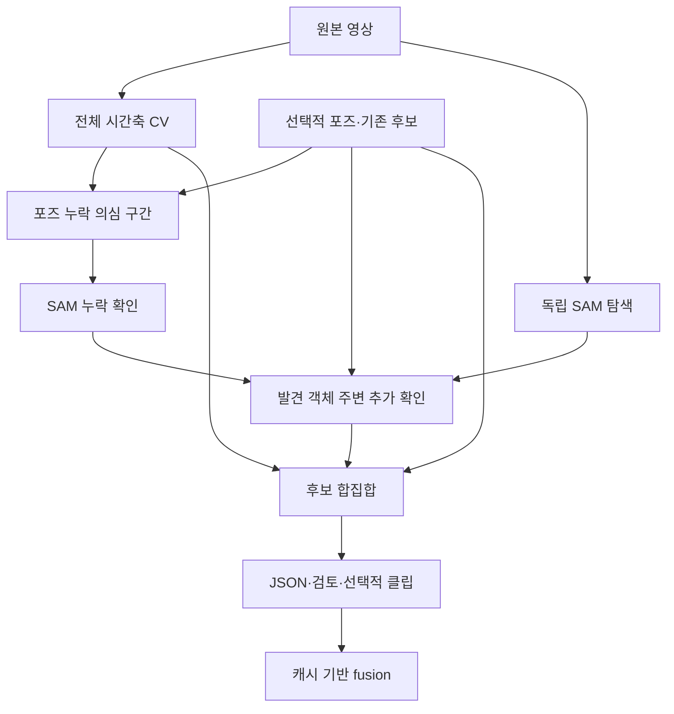

# 포즈에 종속되지 않는 하이라이트 후보 탐색

상태: 구현 사양. `highlight-discover`가 독립 탐색을 담당하고 기존 `highlight-fusion`이
저장된 결과를 겹쳐 보여준다. 이 문서는 후보 발견과 검토의 계약이며 정확도·속도 보증이 아니다.

종목별 경기 단위·하이라이트 유형·구장 탐색은 [종목 SPEC](docs/specs/README.md)의
[배드민턴](docs/specs/badminton.md)·[농구](docs/specs/basketball.md)·[축구](docs/specs/football.md)에 정리한다.
이 종목 엔진들은 후속 구현 설계이며, 여기의 독립 탐색 구현과 구분한다.
SAM3·SAMURAI·공/셔틀 및 구장 전용 모델의 비교는 [모델 조사](docs/research/vision-models-2026-11-19.md)를 따른다.

## 목적과 범위

YOLO Pose로 후보를 먼저 확정한 뒤 SAM3를 호출하면 포즈가 놓친 시간과 이미지 영역을
SAM도 확인하지 못한다. CV, 포즈, SAM의 관측을 합집합으로 수집하고, SAM이 발견한
새 움직임도 검토 후보에 넣는다. 포즈·기존 후보 파일은 선택 입력이다.

이번 구현은 기존 YOLO 포즈 캐시와 SAM3 이미지 검출을 사용한다. SAM 마스크·비디오
추적, 새 포즈 모델 학습, 자동 코트 보정, 외부 LLM 호출은 포함하지 않는다.
포즈가 없는 객체 관측으로 관절을 만들어내지 않는다. 기존 `highlight-detect`,
`highlight-patterns --refine-sam`, `highlight-fusion --refine-sam`의 후보 상세 분석은
기존 방식이며 독립 탐색으로 변경하지 않는다.

## 모듈과 처리 순서

| 모듈 | 입력과 책임 | 출력 |
| --- | --- | --- |
| `discovery_signals.py` | 원본 메타데이터, 선택적 포즈 캐시 검증·움직임 seed, 모든 프레임의 CV와 포즈 관측 가능 상태 수집 | 원본 프레임·시각·움직임·장면/카메라 변화·포즈 상태 |
| `discovery_plan.py` | 순수 함수로 탐색/누락 의심/상세 요청 구성, 시간 분산, 넓은 코트 문맥 영역과 선택적 두 타일 | 프레임·crop·경로·요청 이유 |
| `discovery_sam.py` | 요청별 정확한 프레임 디코딩, 지연 모델 로드, 전역 신규 호출 상한, 디스크 캐시 | 전역 좌표의 원시 객체, 출처, 경로별 비용 |
| `discovery_candidates.py` | CV 피크와 SAM 시간 변화로 seed 생성, 기존 구간에 근거 추가, 제한된 문맥 생성·예산 선택 | 전체 후보와 선택된 검토 후보 |
| `discovery.py` | 단계 연결, CLI 검증, 기록·검토 페이지·선택적 클립 출력 | `discovery.json`, `sam_evidence.json`, 요청·관측·CV 기록 |
| `fusion.py` / `fusion_review.py` | 발견된 후보와 SAM 기록을 재사용하고 원본 시간축으로 표시·근거 검토 | 기존 오버레이·근거 묶음·검토 합본 |



## 요청 계획과 비용

- 신규 SAM 호출 상한 기본 90회. 기본 예약은 탐색 30%, 누락 의심 30%, 나머지는 상세 분석이다.
  양수 예산에서는 탐색을 최소 1회 예약한다. 탐색을 먼저 완료하므로 상세 요청이 탐색 몫을 소진하지 않는다.
  앞 단계가 쓰지 않은 신규 호출 몫은 마지막 상세 단계가 사용할 수 있다.
- 탐색은 기본 5초 간격을 목표로 하되 예약 슬롯이 부족하면 전체 길이에 균등하게 분산한다.
  실제 시각과 최대 관측 간격을 기록한다. 드문 샘플링은 전체 동작의 검출을 보장하지 않는다.
- 누락 의심은 ROI 움직임이 기본 0.04 이상인데 사용 가능한 포즈가 없는/약한 구간이다.
  장면 전환·카메라 이동 의심 프레임은 움직임 seed와 누락 요청에서 제외한다.
  이 기준으로 조용한 장면 전체를 제외하지는 않는다. 독립 탐색은 계속 수행한다.
  카메라 이동은 ROI 위쪽 배경의 평행 이동으로 진단한다. 사람의 상체가 들어가지 않도록 여유를 두며,
  배경 질감이 부족하면 미확인이다. 카메라 이동을 보정하는 기능은 아니다.
- 탐색 crop은 지정 ROI의 바운딩 영역에 상공을 포함한다. 바닥 polygon으로 이미지를 마스킹하지 않는다.
  `--context-tiles 2`는 겹치는 두 세로 타일을 번갈아 탐색하며 각 타일을 별도 호출로 계산한다.
- 상세 요청은 SAM이 본 객체 주변 및 선택적 기존 후보 시점에서 기본 ±0.3초를 확인한다.
  포즈가 없어도 요청을 생성한다. 같은 프레임이어도 다른 crop은 다른 입력이다.
  관측마다 사람과 종목 객체를 번갈아 우선 선택하고, 한쪽이 없으면 나머지를 사용한다.
  같은 위치의 예비 장비가 사람을 계속 밀어내지 않도록 요청을 분산하지만 모든 검출을 재검사하지는 못한다.
- 예산은 신규 이미지 추론 횟수다. 캐시 적중은 신규 호출이 아니며, 요청 수·캐시 적중 수·신규 호출 수를
  별도로 기록한다. 캐시 적중 때문에 상세 계획을 확대하지 않으므로 같은 입력의 재실행에서 탐색 범위가 몰래 늘어나지 않는다.
- 장치 선택은 기존 CUDA/MPS 규칙을 사용한다. CPU 모델 추론으로 조용히 대체하지 않는다.
  모델 로드, 추론, CV/디코딩, 캐시 분석, 클립 출력 시간을 분리한다.

## 관측·캐시 계약

요청은 `frame_index`, `crop`, `branch`, `reason`을 포함한다. 결과의 `decoder_time_s`는
실제로 읽은 원본 프레임의 시각이다. seek 결과 프레임 번호를 검사하고 객체 박스는 원본 픽셀로 변환한다.

추론 캐시 키는 원본·체크포인트의 경로/크기/mtime, 프레임, crop, 프롬프트, 입력 크기,
confidence를 포함한다. 예약 경로와 순위는 이미지 추론 정체성이 아니므로 키에서 제외한다.
키·메타데이터·결과가 맞지 않거나 JSON이 손상된 캐시는 오류로 처리한다. 캐시는 성공한 추론마다 추가 기록한다.
기존 SAM 근거 파일은 별도 입력으로 재사용할 수 있으나, 모델/프롬프트 정보가 없는 오래된 관측을
새 추론 캐시의 적중으로 취급하지 않는다.

원시 객체와 표시/순위 판단을 분리한다. 포즈와 연결되지 않은 관측도 보존하지만,
2D ground ROI만으로 비행 객체의 코트를 확정하지 않는다. 선수 발은 기존과 같이 지정 영역에 여유 폭 0으로 필터한다.
SAM `person` 박스의 하단 중앙은 발의 추정값일 뿐이며, 영역 밖인 사람은 동작 근거에서 제외한다.

## 후보 생성과 검토

- CV의 반복된 움직임 피크는 독립적인 검토 seed가 된다. 단일 프레임 변화와 장면/카메라 변화는 seed가 아니다.
- SAM의 단일 검출은 추가 확인 요청을 만들 수 있지만 그 자체로 하이라이트 seed가 되지 않는다.
  같은 원래 라벨의 인접 관측에서 제한된 시간 간격과 위치 변화가 확인될 때 검토 seed를 만든다.
  동일 프레임의 여러 crop은 시간 변화가 아니다. 정지 물체와 미검출은 동작/타구 증거가 아니다.
- SAM 시간 변화는 보수적인 위치 연결일 뿐 실제 객체 ID·비행·타구를 검증하지 않는다.
  선수와 연결되지 않은 결과는 `needs_review`로 남기고 코트 관계를 `unknown`으로 표시한다.
- 새 seed가 기존 구간 안에 있으면 근거만 덧붙인다. 기존 구간의 시간·경계 상태를 변경하지 않는다.
  새 움직임 문맥은 기본 앞 12초/뒤 8초 안에서 구성하며 서로 겹치지 않게 나눈다.
  랠리의 서브·착지·득점 경계를 새로 확인했다고 표시하지 않는다.
- 선택은 SAM/CV/기존 후보 경로가 한 경로에 밀리지 않도록 번갈아 수행한다.
  개수·총길이 예산을 넘는 구간은 자르지 않고 건너뛴다. 제외된 후보도 `all_units`에 남긴다.
- `discovery.json`의 `units`는 선택된 검토 후보이며 `highlight-fusion --candidates`에 전달할 수 있다.
  원본 프레임과 실제 관측 ID를 근거로 넘기며, LLM은 존재하는 ID만 인용하고 경계를 새로 검증할 수 없다.

## CLI와 산출물

```sh
# 선택 사항: 먼저 기존 명령으로 포즈 캐시를 생성합니다.
uv run highlight-pose game.mp4 --device mps --no-overlay --out-dir outputs/pose

# 포즈 또는 기존 후보를 생략해도 CV와 독립 SAM 탐색이 실행됩니다.
uv run highlight-discover game.mp4 --sport badminton --court court.json \
  --poses outputs/pose/game_poses.npz --sam-model models/sam3.pt --device mps \
  --max-sam-calls 90 --out-dir outputs/discovery/game

# 모델 추론 없이 CV·요청 계획만 점검합니다.
uv run highlight-discover game.mp4 --sport badminton --court court.json \
  --plan-only --out-dir outputs/discovery/plan

# 저장된 발견 후보와 SAM 관측을 전체 오버레이로 표시합니다. 포즈는 선택 사항입니다.
uv run highlight-fusion game.mp4 --sport badminton --court court.json \
  --candidates outputs/discovery/game/discovery.json \
  --sam-evidence outputs/discovery/game/sam_evidence.json --out-dir outputs/fusion/game
```

| 파일 | 내용 |
| --- | --- |
| `discovery.json` | 원본·설정·단계별 비용·전체/선택 후보·예약/실제 호출·관측 간격 |
| `opencv.jsonl` | 전체 프레임 CV와 포즈 관측 가능 상태 |
| `sam_requests.json` | 계획된 요청과 실행/캐시/예산 상태 |
| `sam_observations.json` | 표시 여부와 무관한 SAM 원시/연결 관측 |
| `sam_evidence.json` | fusion/기존 캐시 분석에 전달할 원본 좌표의 SAM 근거 |
| `sam-cache.jsonl` | 기본 신규 추론 캐시; `--sam-cache`로 공유 파일 지정 가능 |
| `review.html` | 후보의 발견 경로·근거·미확인 상태; `--export-clips`일 때만 영상 생성 |

## 수용 기준

1. 포즈·기존 후보가 없고 CV 움직임이 작아도 독립 탐색과 SAM 시간 변화에서 새 검토 후보가 나온다.
2. 포즈가 없는 큰 ROI 움직임이 누락 확인 요청을 만든다. 옆 코트 선수는 포즈 근거를 제공하지 않는다.
3. 정지 물체·동일 프레임 crop 중복·미검출·장면 전환은 SAM 동작 seed가 되지 않는다.
4. 전체 신규 호출은 상한 이하이고 독립 탐색 몫이 먼저 실행된다. 시간과 타일의 관측 공백이 기록된다.
5. 모델·원본·프롬프트·crop 변경 시 추론 캐시를 재사용하지 않는다. 정확히 같은 요청은 신규 호출 없이 재사용한다.
6. 기존 이벤트 구간을 변경/트리밍하지 않는다. 생성한 문맥과 관심도 판단은 경계 검증과 분리한다.
7. 합성 영상과 가짜 검출기로 CLI → 발견 → fusion → 근거 검토를 모델 추론 없이 검사한다.

실제 정확도 검증은 별도다. 동일 처리 시간 예산에서 기존 방식과 비교하고, 기존 포즈 후보 밖을 포함해
사람이 라벨링한 장면으로 복구된 실제 하이라이트·추가 오탐·코트 혼입을 측정해야 한다.
