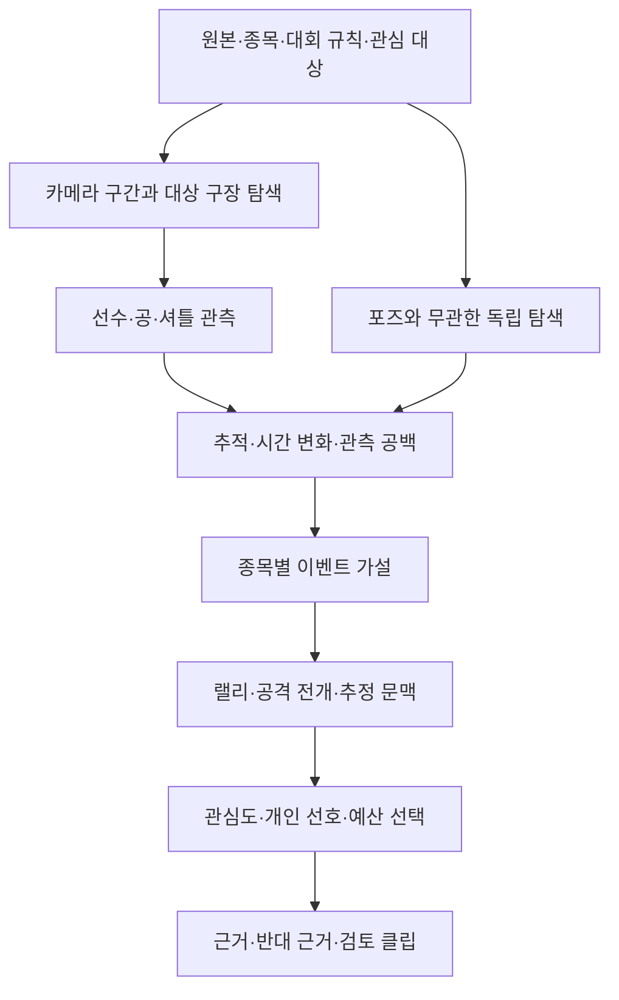

# 종목별 하이라이트 분석 SPEC

작성·자료 확인: 2026-11-19. 아래는 **추가 구현을 위한 설계**다. 현재 실행되는 독립 탐색은
[루트 SPEC](../../SPEC.md), 모델 조사와 도입 순서는 [모델 비교](../research/vision-models-2026-11-19.md)를 따른다.
선택적 YOLO 객체·외부 모델 결과를 합치는 [모델 혼합](model-mix.md)은 구현된 실행·입력 계약이다.

| 종목 | 플레이 단위 | 중요한 공간 | 상세 사양 |
| --- | --- | --- | --- |
| 배드민턴 | 서브부터 랠리 종료까지; 관측이 부족하면 랠리 후보 | 단·복식 경계, 서비스라인, 네트의 바닥 기준 위치 | [badminton.md](badminton.md) |
| 농구 | 공격 전개·슛·후속 리바운드/수비; 소유권이 불명확하면 전개 후보 | 선택한 코트/골대, 페인트존, 3점선, 림 주변 | [basketball.md](basketball.md) |
| 축구 | 공격 전개·슈팅·세이브/골/중단; 득점이 없어도 후보 가능 | 선택한 구장, 공격 방향, 페널티지역, 골문 | [football.md](football.md) |

## 구현된 것과 설계된 것

| 기능 | 현재 상태 |
| --- | --- |
| CV·선택적 포즈·독립 SAM 이미지 관측, 호출 예산·캐시·검토 후보 합집합 | 구현: `highlight-discover` |
| 독립 YOLO 객체 호출, 외부 TrackNet CSV/상자 결과 입력·후보·겹쳐 보기 | 구현: 모델 결과 혼합; 외부 모델 자체 실행은 별도 |
| 명시한 polygon의 선수 발 필터, 배드민턴 바닥 교차점의 수동 보정 | 구현: 코트 탐색/식별 자동화는 없음 |
| 명시한 경기 이벤트로 랠리·득점 구간 구성 | 구현: 이벤트 검출 모델 자체는 별도 |
| 농구의 공·림 상대 위치 규칙 | 구현: 추정 증거이며 공식 득점 확인 아님 |
| 종목별 자동 구장 탐색, 공/셔틀 전용 추적, 소유권·행동 모델 | 아래 문서의 설계; 미연동 |
| SAMURAI, SAM 3.1 비디오, TrackNetV3, KaliCalib, PnLCalib, T-DEED | 조사 후보; 설치·추론·Mac 실측하지 않음 |

현재 `fusion_signals.SportProfile`은 프롬프트·클래스·표면만 구분한다.
`--sport` 값이 있다고 해당 종목의 모든 경기 규칙을 판정하는 것은 아니다.

## 공통 처리 계약

- 경기 규칙은 **관측을 해석하는 조건**이다. 영상에서 보이지 않은 접촉·착지·골을 규칙으로 만들어내지 않는다.
- 관심도, 이벤트 유형의 확실성, 시작/종료 경계의 검증 상태를 별도 필드로 유지한다.
  좋은 플레이도 경계는 미확인일 수 있고, 검증된 평범한 득점은 관심도가 낮을 수 있다.
- 규칙 프로필은 `sport`, `discipline`, `ruleset_id`, `ruleset_version`, `competition`,
  `court_id`, `period`, `target_player_ids`를 저장한다. 알 수 없는 값은 `unknown`으로 둔다.
  종목 이름만으로 단·복식, FIBA/NBA/3x3, 11인제/풋살을 결정하지 않는다.
- 기존 `SportEvent`의 `source`, `verified`, `data`와 `GameUnit`의 경계 상태를 재사용한다.
  설계상 `data.evidence_refs`, `data.time_interval_s`, `data.camera_epoch`로 근거와 시간 오차를 추가한다.
  이 확장 필드를 해석하는 종목별 자동 엔진은 아직 구현하지 않았다.
- 모든 객체는 원래 라벨과 원본 프레임·PTS·crop을 보존한다. 모델별 관측 ID와 실제 인물 ID는 다르다.
  장면 전환·재탐색 후의 ID를 이전 트랙과 자동으로 동일시하지 않는다.
- `observed`, `interpolated`, `predicted`, `occluded`, `unobserved`를 구분한다.
  TrackNet의 보간, Kalman 예측, SAM 메모리 전파는 직접 관측한 타구/득점 근거가 아니다.
- LLM/VLM은 실제 근거 ID를 인용해 관심도를 검토한다. 공식 경기 결과나 정밀 경계를 새로 검증하지 않는다.

## 구장 탐색: 색상·간격·규격을 함께 사용

1. 카메라가 고정된 구간에서는 여러 시점의 배경과 가림 정보를 모은다. 팬·줌·컷이 있으면 구간을 분리한다.
2. OpenCV 선분/곡선과 색상 후보를 찾는다. 필요하면 종목별 선·교차점 모델이나 SAM의 표면 마스크를 보조로 쓴다.
   SAM의 바닥 마스크만으로 공식 경계·서비스라인·골라인을 확정하지 않는다.
3. 소실점과 교차점을 이용해 여러 규격 템플릿의 투영 가설을 만든다. 원근이 있으므로 픽셀 간격을 미터로 직접 비교하지 않는다.
4. 직선뿐 아니라 교차점의 연결, 선이 끝나는 위치, 원호, 독립적인 추가 선까지 대조한다.
   맞추는 데 쓴 네 점의 오차가 0이라는 사실은 검증이 아니다.
5. 후보 선이 템플릿과 맞는 비율과, 보일 것으로 예상한 템플릿 선의 실제 관측 비율을 모두 평가한다.
   가려진/화면 밖 선은 부재 증거로 쓰지 않는다. 농구선·목재 이음선·다른 코트가 섞인 가설을 반례로 비교한다.
6. 형상을 찾는 문제와 **어느 구장을 분석할지**를 분리한다. 선택한 영상 영역, 네트/골대,
   대상 선수의 지속적인 참여를 결합한다. 가장 움직임이 큰 옆 코트를 자동 선택하지 않는다.
7. 상위 후보가 비슷하거나 지지가 부족하면 `uncalibrated`/`proposed`로 남긴다.
   색상 질문을 필수 입력으로 만들지 않고 상위 가설과 겹쳐 보기 자료를 제공한다.

자동 탐색 출력은 종목 템플릿, 카메라 구간, 사용한 landmark/선 ID, 보정에 쓰지 않은 선의 오차,
가시 범위, 렌즈 왜곡 가정, 대안 가설·차이, 검토 상태를 포함한다. 가중 점수는 보정 성공 확률이 아니다.
표준 도면 수치는 실제 paint edge/선 두께의 정의와 함께 버전 관리한다.

`player_roi`와 물리적 `field_geometry`는 별개다. 실제 경기에서는 선수가 경계 밖으로 나가서 공을 받을 수도 있으므로
분석 ROI는 필요한 주변 공간을 포함할 수 있다. **공급된 ROI의 발 필터 여유 폭은 0**을 유지하고,
인접 구장을 포함하도록 몰래 넓히지 않는다. 바닥 homography를 비행 중인 공·셔틀이나 림·네트 상단에 직접 적용하지 않는다.
화면 밖 코트 모서리를 이미지 모서리에 맞추거나, 전환 전 카메라의 보정을 재사용하지 않는다.

## 종목 모듈의 제안 인터페이스

다음은 새 CLI 옵션이 아닌, 후속 구현의 역할 구분이다.

| 역할 | 책임 |
| --- | --- |
| `RuleSet` | 대회·종목 변형·규칙 판본, 선/점수/플레이 해석 |
| `FieldTemplate` / `FieldCalibrator` | 규격과 landmark, 다중 공간 가설, 가시성·보정 품질 |
| `ObjectAdapter` / `TrackAdapter` | 독립 발견, 지정 대상 추적, 공백·예측 구분 |
| `SportEventProposer` | 종목별 시간 패턴 → 미확정 이벤트 가설과 반례 |
| `PlayResolver` | 관측된 경기 단위 또는 bounded 추정 문맥; 기존 검증 경계 보존 |
| `InterestScorer` | 극적인 동작·전개·상황·개인 선호; 경기 판정과 분리 |

호출 계획·캐시·리소스 제한은 기존 discovery 모듈을 공유한다. 모델을 교체해도 같은 source frame/PTS 계약을 지킨다.
SAM3의 텍스트 탐색은 새 대상을 찾고, SAMURAI/SAM2의 지정 대상 추적은 잃지 않고 따라가는 역할로 연결한다.
추적 실패 시 독립 재탐색을 실행하고, YOLO 포즈가 없다는 이유로 재탐색을 막지 않는다.

## 샘플링과 성능 계약

- 저비용 CV는 대부분/전체 프레임에서 수행한다. 포즈는 낮은 주기, 독립 탐색은 시간 전체에 예산을 예약한다.
- 공·셔틀의 궤적은 낮은 주기의 SAM 이미지 몇 장과 다르다. 필요 구간에서는 모델이 요구하는 **연속 프레임**으로 분석한다.
  짧은 독립 탐색 창도 예약해 포즈 후보 밖을 확인한다. 실제 분석한 구간과 분석하지 않은 구간을 출력한다.
- 종목 문서의 프레임 주기는 초기 실험값이다. 모델의 학습 FPS·연속 입력 길이를 확인하고 실제 PTS를 보존한다.
  임의 stride로 연속 프레임 모델에 입력하거나 보간한 프레임을 원본 관측으로 표시하지 않는다.
- 모든 무거운 모델을 모든 프레임에 중첩하지 않는다. 필요한 표적·시간·crop에 모델별 예산을 배분한다.
- 모델 로드/새 추론/캐시 분석/디코딩·전송/인코딩을 분리한다. MPS·CUDA·변환된 Core ML 결과는 각자 검증한다.
  공식 H100/RTX FPS를 Mac 예상 시간으로 사용하지 않는다. CPU 전용 보조 모델은 명시적으로 선택하며 조용한 fallback은 금지한다.

## 검증과 도입 순서

1. 서로 다른 구장·카메라의 작은 라벨 세트를 먼저 만든다. 기존 포즈 후보 밖의 조용한/누락 장면도 포함한다.
2. 공간 검증은 held-out landmark/선 오차와 잘못된 구장 선택률, 추적은 관측 오차·누락·ID 전환을 측정한다.
3. 이벤트 시점 검출, 경기 단위의 완결성, 사람이 원하는 하이라이트 적중률은 각각 평가한다.
   같은 경기를 잘게 나눠 train/test에 섞지 않고 경기·구장·카메라별로 분리한다.
4. 신뢰도·관심도 임계값과 호출 예산은 이 데이터에서 정한다. 초기 수치로 정확도 향상을 주장하지 않는다.
5. 우선 배드민턴 대상 코트 보정을 바로잡고 셔틀 전용 추적을 비교한다. 다음은 농구 코트/림·공,
   축구의 카메라 변화·구장 보정·공·이벤트 spotting 순으로 확장한다.
6. 모델 연결 전 합성/기록 재생 테스트로 코트 혼입·보간 근거·ID·경계 불변식을 검사하고, 이후 Mac 실측을 별도로 수행한다.
