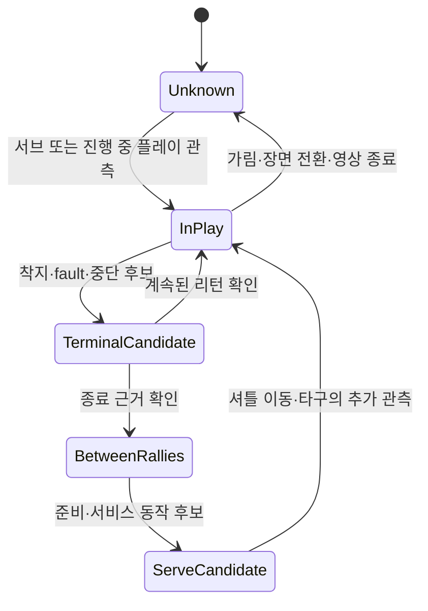

# 배드민턴 하이라이트 SPEC

상태: 종목 엔진·자동 코트 탐색의 설계. 현재 지원 범위와 공통 계약은 [공통 SPEC](README.md)을 따른다.
단식과 복식을 구분하고 대회 규칙 판본을 기록한다. 기준 도면은 [BWF Laws, 2025-04-26 v5.0, Diagram A](https://badminton.dk/wp-content/uploads/2025/11/Section-4.1-Laws-of-Badminton-26-April-2025-V5.0-1-.pdf)다.
점수제는 대회 설정에서 읽으며 코트 도면의 판본만으로 현재 영상의 점수제를 결정하지 않는다.

## 하이라이트와 필요한 증거

| 후보 장면 | 발견 신호 | 추가 확인 | 이것만으로 확정하지 않는 것 |
| --- | --- | --- | --- |
| 긴 랠리·빠른 공방 | 반복된 양쪽 움직임, 셔틀 왕복 관측 | 시간 공백을 포함한 랠리 전개, 참가 선수 | 단순히 오래 움직였다고 완결된 랠리 |
| 강한 스매시와 수비 | 팔·몸의 가속, 관측된 셔틀 속도/방향 변화 | 타구 주변 연속 프레임, 상대의 반응과 리턴 | 오버헤드 포즈만으로 스매시·위너 |
| 헤어핀·네트 대결·속임수 | 네트 가까운 작은 손목/라켓 동작, 전후 회복 | 셔틀·라켓·네트의 상대 위치와 시간 순서 | 오버헤드나 큰 스윙을 필수 조건으로 사용 |
| 다이빙·급한 런지·끝까지 살린 수비 | 발 이동, 무게중심 급변, 낮은 자세 | 실제 리턴 여부, 줍기/넘어짐과 구분 | 낮은 자세만으로 수비 성공 |
| 전후좌우 전환·강한 복식 연계 | 선수 이동과 연속 타구 후보 | 같은 코트의 연결된 플레이 | 옆 코트의 움직임과 합친 긴 랠리 |
| 중요한 점수 상황의 플레이 | 검증 가능한 점수/게임 상황, 사용자 선호 | 당시 랠리와 결과의 출처 | 점수 OCR 한 장으로 매치 포인트·승자 |

`rally_interest`는 다양성·전환·수비·네트 플레이·랠리 길이·개인 선호를 따로 기록한다.
셔틀 속도는 원본 시각과 영상 좌표의 측정값이며, 3D 보정 없이 km/h로 바꾸지 않는다.
셔틀/라켓 미검출은 포즈·CV 후보를 제거하는 조건이 아니다.

## 코트 탐색

복식 도면은 가로 6.1m·세로 13.4m, 단식 폭은 5.18m다. 네트는 길이 중앙에 있고 숏서비스라인은
네트에서 1.98m 떨어진다. 아래 숫자는 위 BWF 도면의 명목 좌표이며 paint edge/선 두께의 기준도 보정에 반영한다.

1. 배경에서 색상별 직선 후보를 찾되 색상을 미리 고정하지 않는다. 가로·세로 선의 소실점과 교차점을 묶는다.
2. 외곽, 단식 사이드라인, 숏서비스, 복식 롱서비스, 부분 센터라인을 **한 도면의 연결 관계**로 맞춘다.
   단순한 사각형이나 평행선 두 개만 맞는 농구선/옆 코트는 충분한 근거가 아니다.
3. 화면에 보이는 서비스라인 교차점을 사용해 투영 가설을 만들고, fit에 쓰지 않은 다른 서비스/사이드라인으로 검증한다.
   센터라인이 네트를 가로질러 계속 그려지는 잘못된 도면을 거부한다.
4. 네트의 바닥 위치와 네트 상단 테이프를 구분한다. 이동식 기둥 받침·바퀴를 코트 모서리로 사용하지 않는다.
5. 여러 코트를 각각 후보로 유지하고 선택한 영역·네트·대상 선수의 참여로 주 코트를 정한다.
   같은 색의 옆 코트나 더 활발한 코트가 선택되지 않아야 한다.
6. 부분 코트·가림·반사에서는 모서리를 억지로 완성하지 않는다. 규격상 서로 다른 가설이 남으면 미확인으로 보존한다.

단식은 좁은 사이드라인, 복식은 넓은 사이드라인을 사용한다. 서브의 유효 영역과 랠리 중 유효 영역도 구분한다.
발 필터는 공급된 선수 ROI에 적용하며, 실제 코트 밖으로 발을 내딛는 정상 수비를 물리적 경계만으로 배제하지 않는다.
기존 영상 `199_0HDQ-d8`의 수동 ROI는 실제 선과 맞지 않았으므로 정답 보정 데이터로 사용하지 않는다.

## 경기 단위와 경계

- 편집 단위는 보통 서브부터 랠리 종료까지다. 종료에는 착지뿐 아니라 관측된 fault·let·명시적 중단도 있다.
  let으로 중단된 랠리를 득점으로 계산하지 않는다.
- 영상이 랠리 중 시작되면 시작 경계는 미확인이다. 휴지·추적 상실·셔틀이 사라진 프레임은 착지 근거가 아니다.
- 바닥 근처의 작은 셔틀과 속도 감소만으로 착지를 확정하지 않는다. 착지 전후의 직접 관측이나 명시적 이벤트가 필요하다.
  점수판 갱신은 랠리 종료를 보조하지만 지연될 수 있으므로 정확한 착지 시각을 제공하지 않는다.
- 상태가 불명확하면 기존 앞 12초/뒤 8초 안의 추정 문맥을 사용하고 `rally_candidate`로 남긴다.
  경계를 확인한 랠리는 전체 단위로 선택/건너뛰며 하이라이트 예산에 맞춰 중간을 자르지 않는다.

## 모델과 실행 계획

| 역할 | 우선 후보 | 사용 범위 |
| --- | --- | --- |
| 선수·동작 | 기존 YOLO Pose; RTMPose 비교 후보 | 낮은 주기의 전역 관측 + 어려운 선수 crop 재검사 |
| 셔틀 위치 | [TrackNetV3](https://github.com/qaz812345/TrackNetV3) | 별도 예약한 탐색 창과 후보 주변의 연속 프레임; 도메인·FPS 적합성 평가 |
| 독립 객체 발견 | 기존 SAM3 이미지; YOLOE 비교 후보 | 포즈가 없는 시간에도 예산 예약, 코트 상공 포함 |
| 지정 대상의 가림·추적 | [SAMURAI](https://github.com/yangchris11/samurai) / SAM2.1 | 초기 대상을 정한 짧은 구간. 작은 셔틀의 기본 추적기로 채택하기 전에 비교 |
| 코트 | OpenCV + 규격 템플릿; 필요시 전용 landmark 모델 | 고정 카메라 구간의 초기 보정과 변화 감시 |

TrackNetV3의 InpaintNet으로 메운 경로와 SAMURAI의 운동 예측은 관측된 좌표와 별도 필드로 저장한다.
빠른 방향 전환·가림·셔틀 바닥 줍기를 포함해 성능을 비교한다. 모델의 공식 데모 속도를 Mac 속도로 사용하지 않는다.
모델별 라이선스·가중치·MPS 상태는 [조사 보고서](../research/vision-models-2026-11-19.md)를 따른다.

## 수용 기준

- 흰색/노란색/초록색 복합 선, 같은 색의 옆 코트, 일부 모서리가 화면 밖인 영상을 구분해 검사한다.
- 보정용 점을 제외한 선에서도 투영 오차가 낮고, 선택한 코트 ID가 여러 시점에서 유지되어야 한다.
- 오버헤드 없는 헤어핀과 포즈 누락 구간도 독립 관측으로 후보가 될 수 있어야 한다.
- 셔틀 줍기·정지 예비 셔틀·옆 코트 플레이가 강한 하이라이트 근거로 승격되지 않아야 한다.
- 타구 사이의 추적 공백과 보간 경로가 서비스/착지/위너 검증으로 변환되지 않아야 한다.
- 단·복식 및 서브/랠리의 경계를 바꿔도 같은 원본 관측을 재사용하고 해석만 달라져야 한다.
- 최종 평가는 셔틀 위치 오차·실제 관측 recall, 코트 혼입률, 랠리 완결성, 사람이 고른 장면의 회수율·오탐·Mac 비용을 분리한다.
